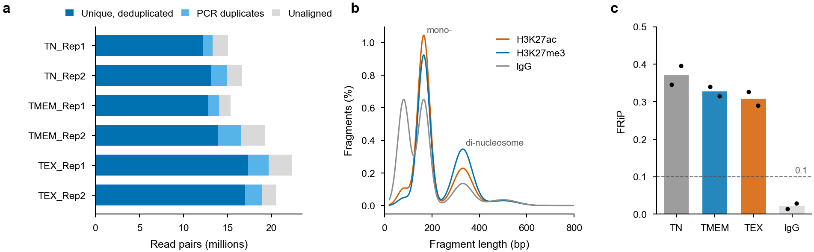
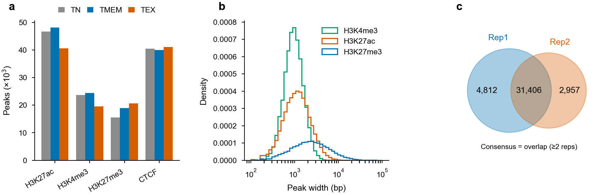
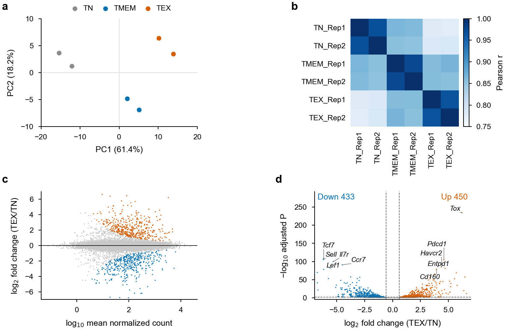
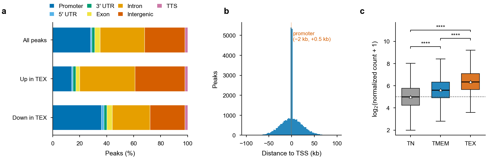
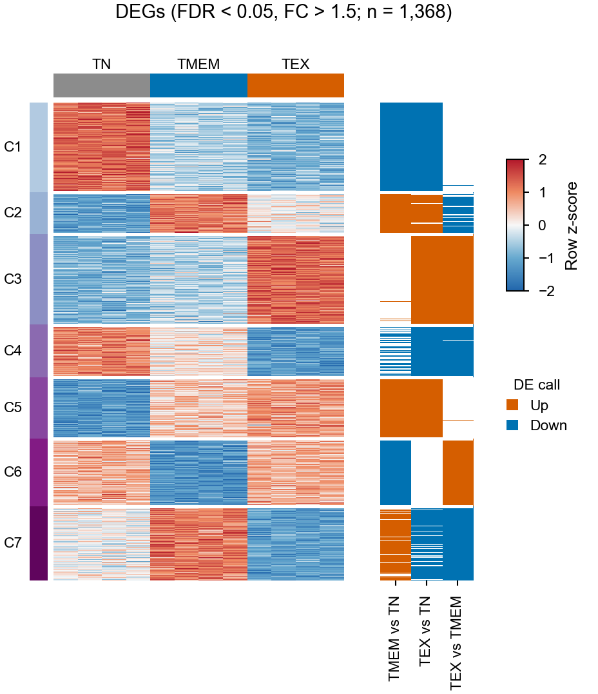
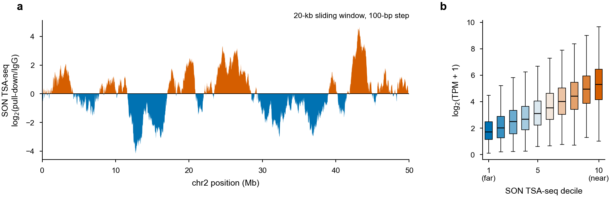
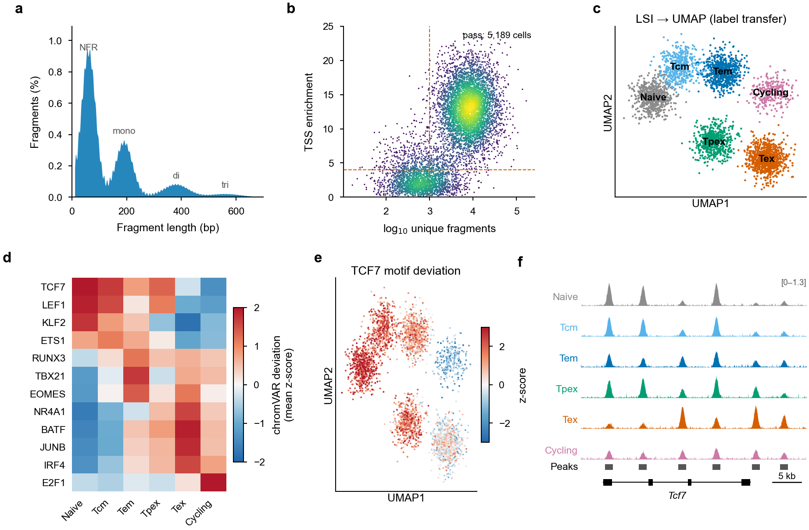
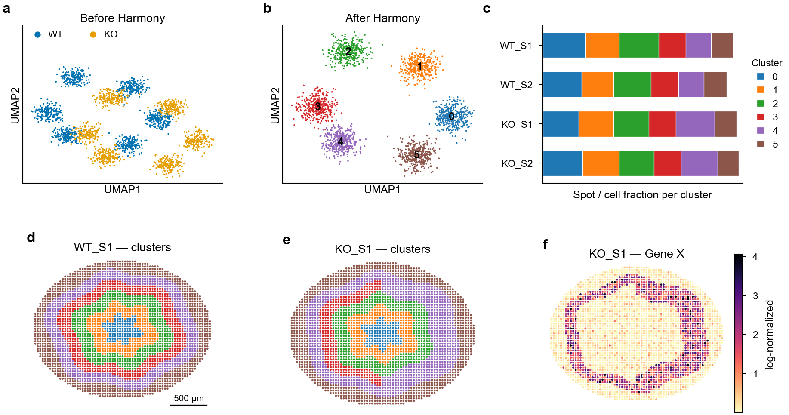

# NGS Analysis Tutorial

A practical guide to NGS analysis: CUT&RUN, ChIP-seq, ATAC-seq, RNA-seq, single-cell, spatial and related assays, from raw reads to publication figures.

Every chapter gives parameterised commands, example outputs, Nature-style example figures and a list of references and resources.

> **About the figures.** All figures in this tutorial are generated from **simulated data** by [`scripts/make_example_figures.py`](scripts/make_example_figures.py). They show what each step produces and how to lay it out for publication; they are not results from any experiment.

---

## Workflow

```text
             ┌──────────────┐   ┌────────────┐   ┌───────────────────┐   ┌──────────────┐
 BaseSpace ─►│ 1 Data in/out│──►│ 2 QC / trim│──►│ 3 Align → BAM → bw│──►│ 4 Peak calls │
 SRA / GEO   └──────────────┘   └────────────┘   └───────────────────┘   └──────┬───────┘
                                                                                │ union peaks
         ┌──────────────────┐   ┌────────────────────┐   ┌──────────────────────▼──────┐
         │ 8 Tracks/heatmaps│◄──│ 7 Motifs / networks│◄──│ 5 Counts → DESeq2 → plots   │
         └──────────────────┘   └────────────────────┘   │ 6 Annotation / GO / GREAT   │
                                                         └─────────────────────────────┘
 RNA-seq ─► 9 STAR → featureCounts → DESeq2 → clustered heatmap
 Nuclear organisation ─► 10 SON TSA-seq · 11 Hi-C / HiChIP
 Screens              ─► 12 pooled CRISPR (MAGeCK)
 Single-cell          ─► 13 scRNA-seq · 14 scATAC-seq (chromVAR, tracks) · 15 spatial
```

## Chapters

| # | Chapter | Covers | Figure |
|---|---|---|---|
| 0 | [Setup](tutorials/00_setup.md) | LSF `bsub`, project layout, reference files, modules, conda, tool installs | — |
| 1 | [Data transfer](tutorials/01_data_transfer.md) | BaseSpace, `bcl2fastq`, SRA, Box, Dropbox, GEO upload, down-sampling | — |
| 2 | [QC & trimming](tutorials/02_qc_trimming.md) | FastQC/MultiQC, Trimmomatic, cutadapt, insert size, strandedness, FRiP | [Fig. 1](tutorials/figures/fig1_qc.png) |
| 3 | [CUT&RUN / ChIP alignment](tutorials/03_alignment_cutrun_chip.md) | bowtie2, filtering, Picard dedup, bigWig, spike-in, parallel jobs | — |
| 4 | [Peak calling](tutorials/04_peak_calling.md) | MACS2 broad/IgG, filtering, consensus & union peaks, overlaps | [Fig. 2](tutorials/figures/fig2_peaks.png) |
| 5 | [Differential analysis](tutorials/05_differential_analysis.md) | `multicov`/featureCounts, DESeq2, PCA, correlation, MA, volcano, box plots | [Fig. 4](tutorials/figures/fig4_differential.png) |
| 6 | [Annotation & enrichment](tutorials/06_annotation_enrichment.md) | HOMER annotation, GREAT, REVIGO, biomaRt, clusterProfiler, Enrichr, Venn | [Fig. 5](tutorials/figures/fig5_annotation_boxplot.png) |
| 7 | [Motif analysis](tutorials/07_motif_analysis.md) | HOMER, MEME AME/FIMO, logos, motif centrality, HINT footprinting, Cytoscape | [Fig. 6](tutorials/figures/fig6_motif_enrichment.png), [Fig. 10](tutorials/figures/fig10_motif_results.png) |
| 8 | [Visualization](tutorials/08_visualization.md) | deepTools heatmaps, pooled bigWigs, UCSC tracks, Gviz | [Fig. 3](tutorials/figures/fig3_profile_heatmap.png), [Fig. 8](tutorials/figures/fig8_genome_tracks.png) |
| 9 | [RNA-seq](tutorials/09_rnaseq.md) | STAR, featureCounts, count cleaning, ComplexHeatmap k-means, SQuIRE | [Fig. 7](tutorials/figures/fig7_rna_kmeans_heatmap.png) |
| 10 | [SON TSA-seq](tutorials/10_tsa_seq.md) | sliding-window normalisation, speckle proximity vs expression | [Fig. 9](tutorials/figures/fig9_tsa_seq.png) |
| 11 | [Hi-C / HiChIP](tutorials/11_hic.md) | HiC-Pro, HiCExplorer (P(s), TADs, insulation, track plots), FitHiChIP, HOMER | [Fig. 12](tutorials/figures/fig12_hic.png) |
| 12 | [CRISPR screens](tutorials/12_crispr_screens.md) | MAGeCK count/test, library QC, rank plot, sgRNA plots, RIGER, CRISPRO | [Fig. 11](tutorials/figures/fig11_crispr_screen.png) |
| 13 | [scRNA-seq](tutorials/13_scrnaseq.md) | Cell Ranger, QC, doublets, Harmony, clustering, markers, annotation, pseudobulk DE, SCENIC | [Fig. 13](tutorials/figures/fig13_scrnaseq.png) |
| 14 | [scATAC-seq](tutorials/14_scatacseq.md) | Signac QC, LSI, label transfer, cell-type peaks, chromVAR, footprints, coverage tracks, ArchR | [Fig. 14](tutorials/figures/fig14_scatac.png) |
| 15 | [Spatial transcriptomics](tutorials/15_spatial.md) | Scanpy + Harmony integration, clusters on tissue, Squidpy neighbourhoods | [Fig. 15](tutorials/figures/fig15_spatial.png) |

## Figure gallery

| | | |
|:-:|:-:|:-:|
| [](tutorials/02_qc_trimming.md) **1** Library QC | [](tutorials/04_peak_calling.md) **2** Peaks | [](tutorials/08_visualization.md) **3** Profile heatmap |
| [](tutorials/05_differential_analysis.md) **4** Differential | [](tutorials/06_annotation_enrichment.md) **5** Annotation | [](tutorials/07_motif_analysis.md) **6** Motifs & GO |
| [](tutorials/09_rnaseq.md) **7** RNA k-means | [](tutorials/08_visualization.md) **8** Tracks | [](tutorials/10_tsa_seq.md) **9** TSA-seq |
| [](tutorials/07_motif_analysis.md) **10** Motif results | [](tutorials/12_crispr_screens.md) **11** CRISPR screen | [](tutorials/11_hic.md) **12** Hi-C |
| [](tutorials/13_scrnaseq.md) **13** scRNA-seq | [](tutorials/14_scatacseq.md) **14** scATAC-seq | [](tutorials/15_spatial.md) **15** Spatial |

### Figure style (Nature guidelines)

| Element | Setting |
|---|---|
| Width | 89 mm (single column) or 183 mm (double column) |
| Font | Arial/Helvetica, 5–7 pt; bold lowercase panel letters (**a**, **b**, …) |
| Lines | 0.25–0.5 pt axes, outward ticks, no top/right frame |
| Colour | colour-blind-safe Okabe–Ito palette; red–blue diverging for z-scores |
| Export | vector PDF with embedded fonts (`pdf.fonttype 42` / `cairo_pdf`); dense scatter/heatmap layers rasterized at 300 dpi |
| Legends | state *n*, the statistical test, the error-bar definition and the thresholds |

R users: `theme_nature()` and `save_fig()` are defined in [chapter 5](tutorials/05_differential_analysis.md#53-plot-functions-nature-style). Python users: copy the `rcParams` block at the top of `scripts/make_example_figures.py`.

Regenerate every figure (PNG + PDF):

```bash
python3 scripts/make_example_figures.py      # needs numpy, scipy, matplotlib
```

---

## Common pitfalls covered in this tutorial

| Where | Pitfall | Recommendation |
|---|---|---|
| MACS2 on paired-end CUT&RUN (ch. 4) | `-f BAM` ignores mate information | `-f BAMPE` |
| Spatial / single-cell integration (ch. 13, 15) | `neighbors()` ran on uncorrected PCs; Harmony block skipped normalisation | `use_rep="X_pca_harmony"`; normalise once before PCA |
| HOMER motif plots (ch. 7) | `log10(exp(LogP))` underflows to −∞ | `LogP / log(10)` |
| rGREAT (ch. 6) | `adv_oneDistance` is in kb (5000 = 5 Mb) | documented; default 1000 kb |
| DESeq2 peaks (ch. 5) | factor levels follow file order | list the reference condition first in the sample sheet |
| bowtie2 logging (ch. 3) | `2>` after a pipe captures samtools, not bowtie2, stderr | redirect on the bowtie2 call |
| bigWig via bedGraph (ch. 3) | unsorted bedGraph passed to `bedGraphToBigWig` | sort first |
| Pooling bigWigs (ch. 8) | summing replicates changes the scale | `bigwigAverage` / `wiggletools mean` |
| scATAC barcode renaming (ch. 14) | global substitution edits the whole SAM line | edit the `CB:Z:` tag only |
| featureCounts ≥ 2.0.2 (ch. 5, 9) | `-p` alone counts reads | add `--countReadPairs` |
| Credentials (ch. 1) | tokens/passwords written into scripts | keep them in `~/.secrets` (chmod 600) |
| scRNA-seq DE (ch. 13) | cells treated as replicates inflate significance | pseudobulk per sample + DESeq2 |
| scATAC LSI (ch. 14) | LSI component 1 tracks sequencing depth | use components 2–30 |
| CRISPR hits (ch. 12) | a single extreme guide | require several concordant guides outside the non-targeting range |
