# NGS Analysis Tutorial

Useful functions to NGS analysis: CUT&RUN, ChIP-seq, ATAC-seq, RNA-seq, single-cell, spatial and related assays, from raw reads to publication figures.

Every part gives parameterised commands, example outputs, Nature-style example figures directly after the relevant functions, and a list of references and resources. Figures are shown inline in each part; click a figure label to open its vector PDF.

---

## Workflow

```text
FASTQ ─► QC / trimming ─► alignment ─► signal tracks + peaks or gene counts
      ─► differential analysis ─► annotation, enrichment, motifs ─► figures
```

Parts 0–8 follow this path for CUT&RUN, ChIP-seq and ATAC-seq; parts 9–15 adapt it to other assays; parts 16–18 are reusable R figure recipes.

## Parts

Open a part for functions and commands; click a figure to enlarge it.

| # | Part | Covers | Example figure |
|---|---|---|:-:|
| 0 | [Setup](tutorials/00_setup.md) | LSF `bsub`, project layout, reference files, modules, conda, tool installs | — |
| 1 | [Data transfer](tutorials/01_data_transfer.md) | BaseSpace, `bcl2fastq`, SRA, Box, Dropbox, GEO upload, down-sampling | — |
| 2 | [QC & trimming](tutorials/02_qc_trimming.md) | FastQC/MultiQC, Trimmomatic, cutadapt, insert size, strandedness, FRiP | 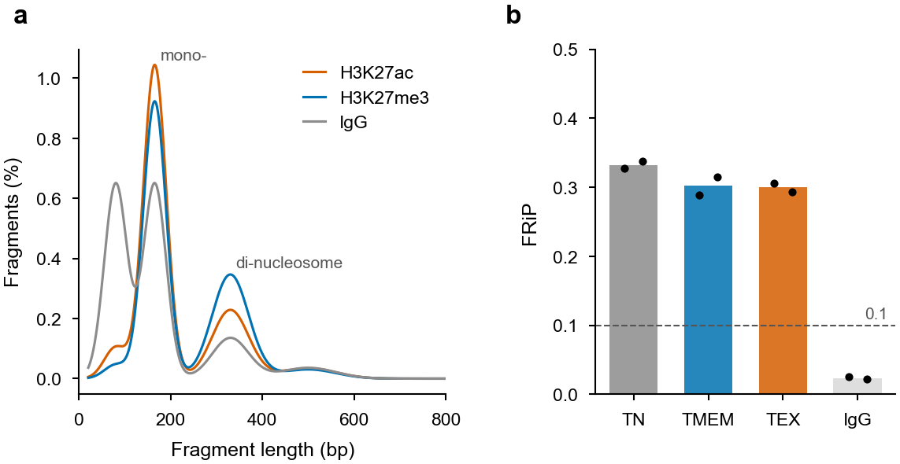 |
| 3 | [CUT&RUN / ChIP alignment](tutorials/03_alignment_cutrun_chip.md) | bowtie2, filtering, Picard dedup, bigWig, spike-in, parallel jobs | — |
| 4 | [Peak calling](tutorials/04_peak_calling.md) | MACS2 broad/IgG, filtering, consensus & union peaks, overlaps |  |
| 5 | [Differential analysis](tutorials/05_differential_analysis.md) | `multicov`/featureCounts, DESeq2, PCA, correlation, MA, volcano, box plots | 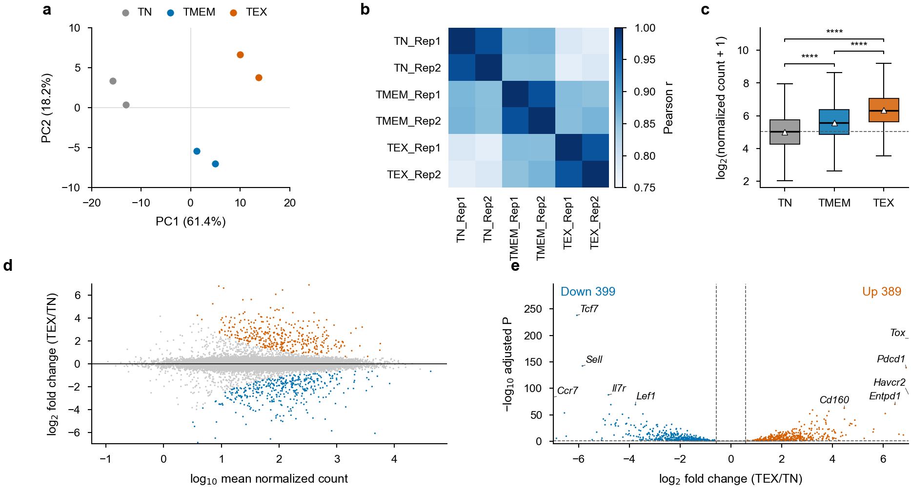 |
| 6 | [Annotation & enrichment](tutorials/06_annotation_enrichment.md) | HOMER annotation, GREAT, REVIGO, biomaRt, clusterProfiler, Enrichr, Venn | 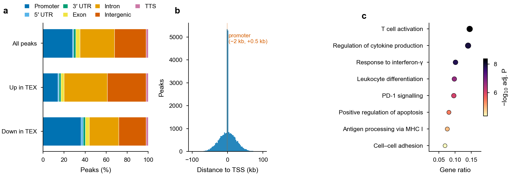 |
| 7 | [Motif analysis](tutorials/07_motif_analysis.md) | HOMER, MEME AME/FIMO, logos, motif centrality, HINT footprinting, Cytoscape | 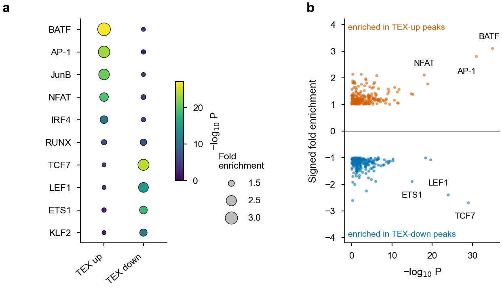 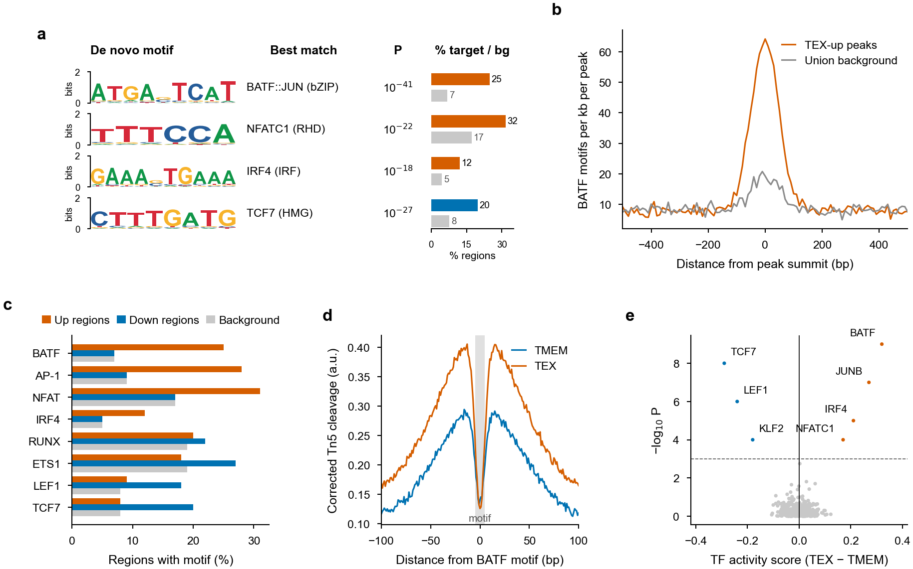 |
| 8 | [Visualization](tutorials/08_visualization.md) | deepTools heatmaps, pooled bigWigs, UCSC tracks, Gviz | 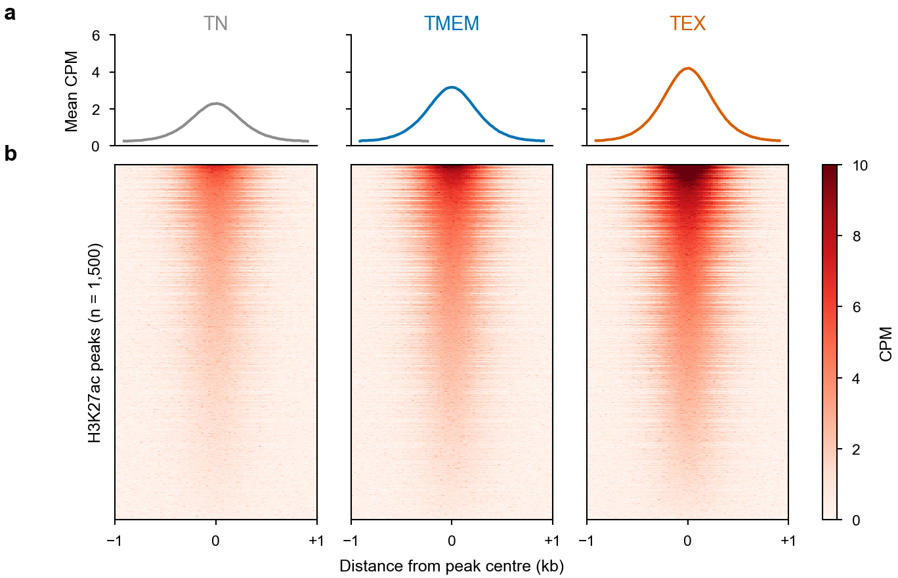 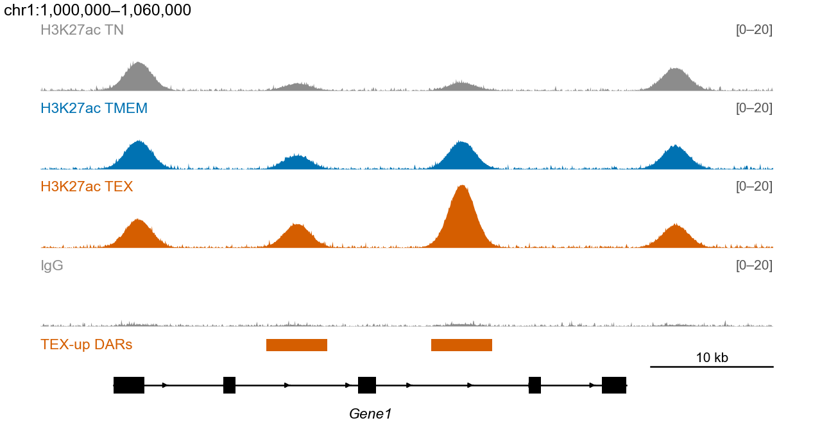 |
| 9 | [RNA-seq](tutorials/09_rnaseq.md) | STAR, featureCounts, count cleaning, ComplexHeatmap k-means, GSEA (GSEA-CLI, fgsea, running-ES plots), SQuIRE | 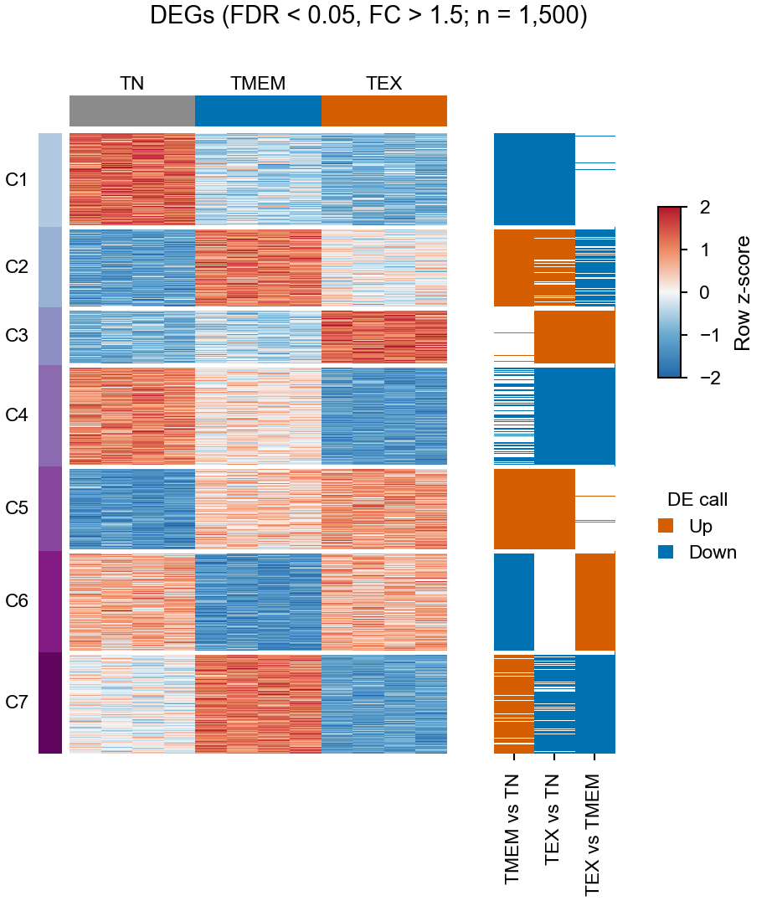 |
| 10 | [SON TSA-seq](tutorials/10_tsa_seq.md) | sliding-window normalisation, speckle proximity vs expression | 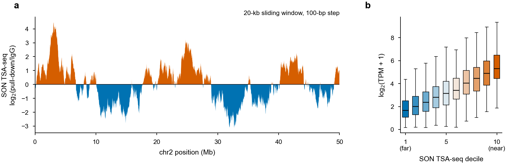 |
| 11 | [Hi-C / HiChIP](tutorials/11_hic.md) | HiC-Pro, HiCExplorer (P(s), TADs, insulation, track plots), FitHiChIP, HOMER | 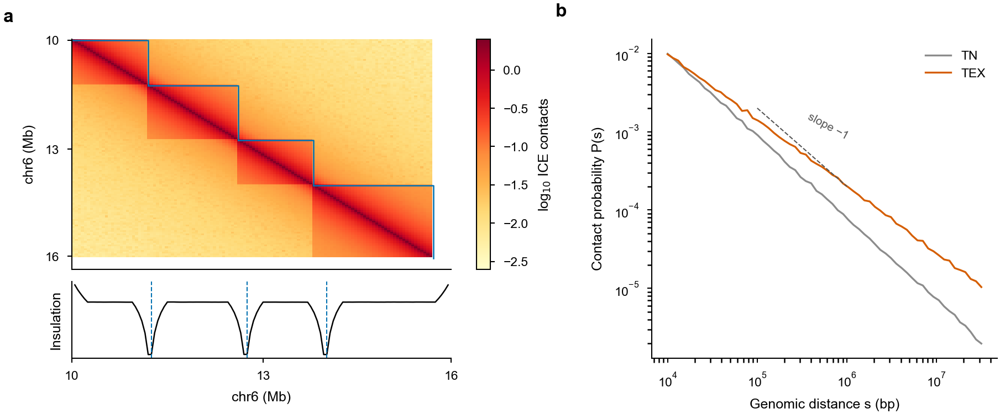 |
| 12 | [CRISPR screens](tutorials/12_crispr_screens.md) | MAGeCK count/test, merging per-sample count tables, library QC, rank plot, sgRNA plots, RIGER, CRISPRO | 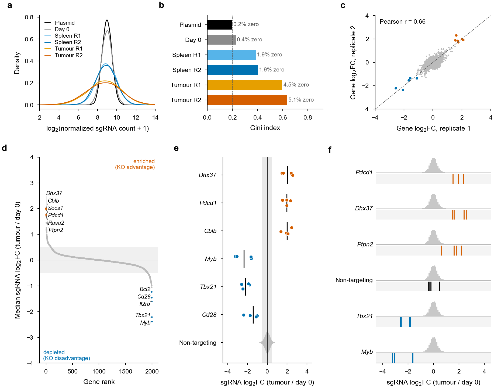 |
| 13 | [scRNA-seq](tutorials/13_scrnaseq.md) | Cell Ranger, QC, doublets, Harmony, clustering, markers, annotation, pseudobulk DE, SCENIC | 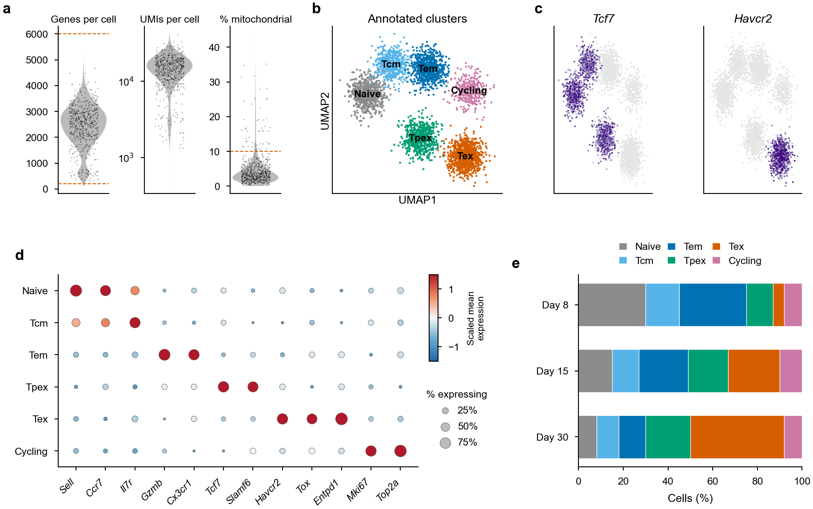 |
| 14 | [scATAC-seq](tutorials/14_scatacseq.md) | Signac QC, LSI, label transfer, cell-type peaks, chromVAR, footprints, coverage tracks, ArchR | 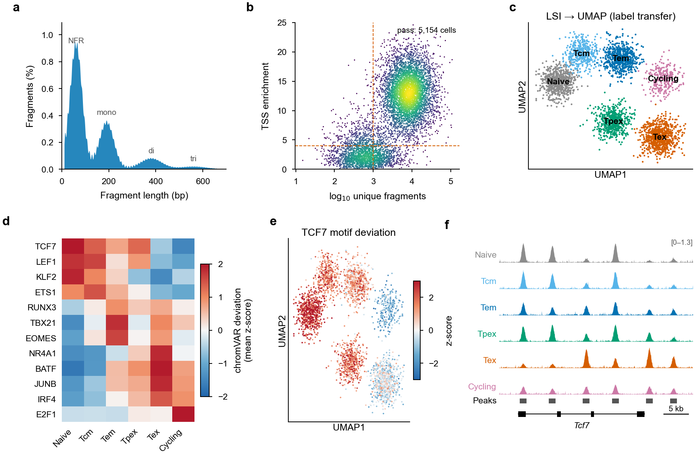 |
| 15 | [Spatial transcriptomics](tutorials/15_spatial.md) | Scanpy + Harmony integration, clusters on tissue, Squidpy neighbourhoods | 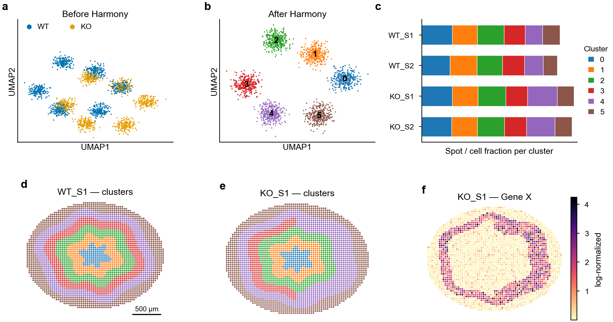 |
| 16 | [PCA plots](tutorials/16_pca_plot.md) | rlog/VST input, colour by condition + shape by guide, PC1/2 and PC2/3 | 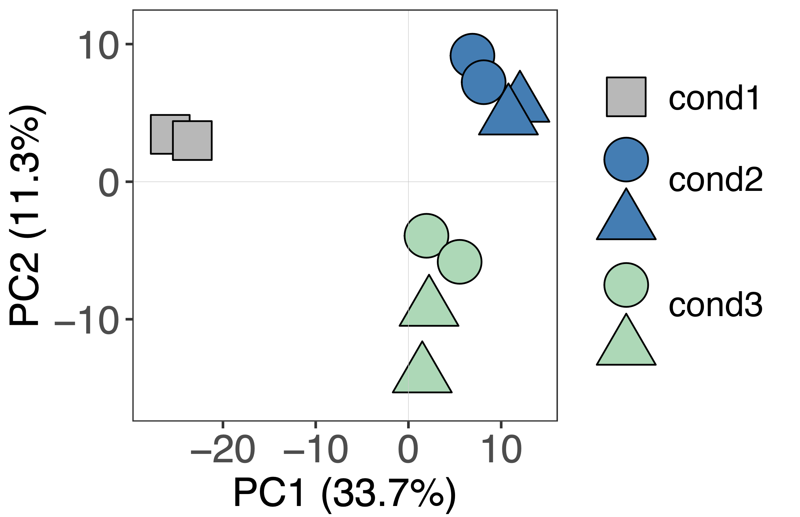 |
| 17 | [ComplexHeatmap](tutorials/17_complexheatmap.md) | row z-scores, column split by condition, labelled genes (`anno_mark`) | 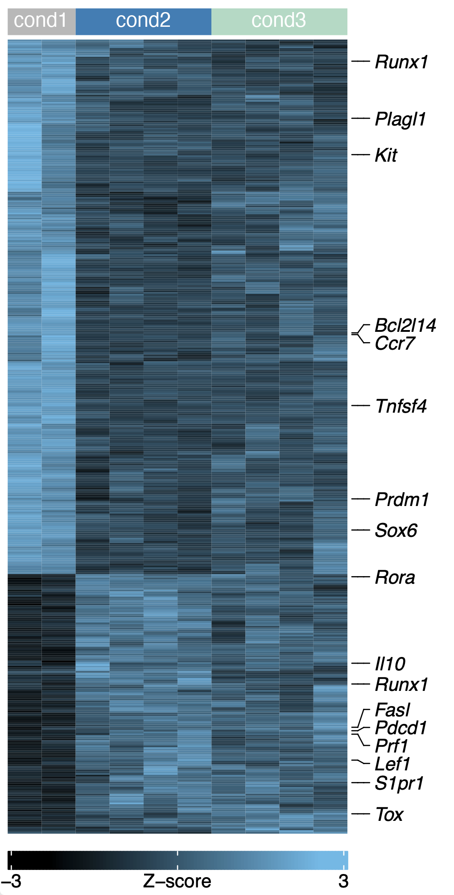 |
| 18 | [Gviz highlighted tracks](tutorials/18_gviz_tracks.md) | bigWig tracks per condition, TxDb gene models, highlighted DERs and motif sites, loop over regions | 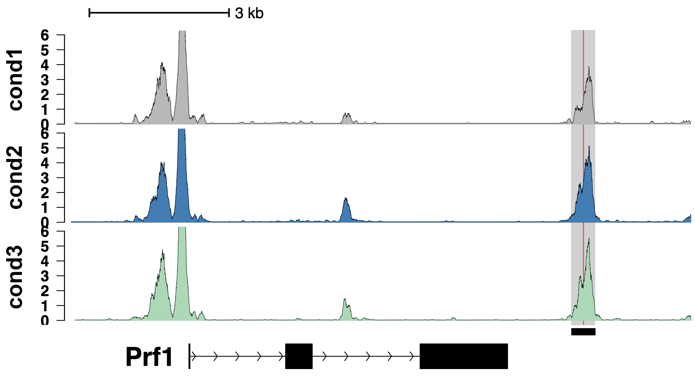 |

## Figure style (Nature guidelines)

| Element | Setting |
|---|---|
| Width | 89 mm (single column) or 183 mm (double column) |
| Font | Arial/Helvetica, 5–7 pt; bold lowercase panel letters (**a**, **b**, …) |
| Lines | 0.25–0.5 pt axes, outward ticks, no top/right frame |
| Colour | colour-blind-safe Okabe–Ito palette; red–blue diverging for z-scores |
| Export | vector PDF with embedded fonts (`pdf.fonttype 42` / `cairo_pdf`); dense scatter/heatmap layers rasterized at 300 dpi |
| Legends | state *n*, the statistical test, the error-bar definition and the thresholds |

R users: `theme_nature()` and `save_fig()` are defined in [part 5](tutorials/05_differential_analysis.md#53-plot-functions-nature-style). Python users: copy the `rcParams` block at the top of `scripts/make_example_figures.py`.

Regenerate the figures of parts 2–15 (PDF, plus the PNGs shown here and on each page):

```bash
python3 scripts/make_example_figures.py      # needs numpy, scipy, matplotlib
```
