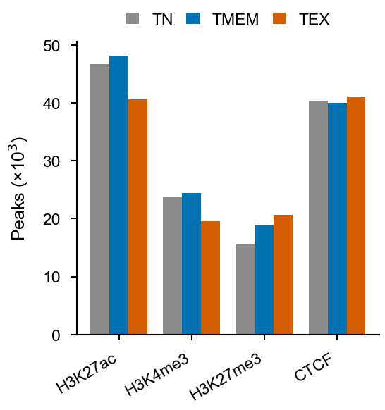
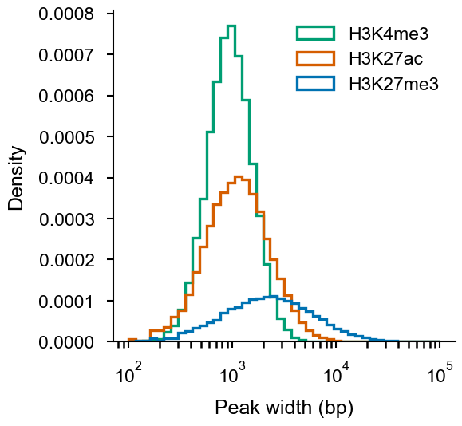
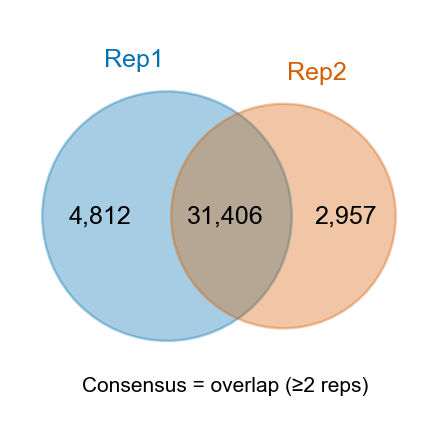

# Part 4 · Peak calling and consensus peak sets

[← Alignment](03_alignment_cutrun_chip.md) · [Index](../README.md) · [Next: Differential analysis →](05_differential_analysis.md)

This part follows a four-step peak-calling workflow:

1. Call **broad peaks** per replicate with MACS2.
2. Call permissive peaks on **IgG** and treat them as background artefacts.
3. Filter, then remove blacklist and IgG regions.
4. Build a **consensus** set per condition (overlap of ≥ 2 replicates) and a **union** set across conditions for counting (part 5).

---

## 4.1 MACS2 per replicate

`call_peaks_macs2.sh <SAMPLE> <SPECIES> <WORKDIR>`

```bash
#!/bin/bash
set -euo pipefail
Sample_ID=$1; SPECIES=$2; WORKDIR=$3
GNM_IDX=/path/to/indexes/${SPECIES}
BLACKLIST=${GNM_IDX}/${SPECIES}-blacklist.clean.bed
GSIZE=2.7e9                        # human; use 1.87e9 for mouse
cd ${WORKDIR}

min_wid=100; max_gap=300
qval=0.05;  tag="qval0.05"
prefix=peak_${Sample_ID}_${tag}_minwid${min_wid}_maxgap${max_gap}

macs2 callpeak -t BAM/${Sample_ID}.map.dedup.bam \
  -f BAMPE -g ${GSIZE} -q ${qval} --broad \
  --min-length ${min_wid} --max-gap ${max_gap} \
  --keep-dup all \
  --outdir Peak -n ${prefix} 2> Peak/${prefix}.log

## filter + clean: FC > 1.2 and P < 0.05 (-log10 P > 1.3); drop blacklist overlaps
grep -v '^track' Peak/${prefix}_peaks.broadPeak \
  | awk '$7 > 1.2 && $8 > 1.3' \
  | sort -k1,1 -k2,2n \
  | bedtools intersect -v -a - -b ${BLACKLIST} \
  | awk 'BEGIN{OFS="\t"} {print $1,$2,$3,"'${Sample_ID}'_"NR,$5,$3-$2}' \
  > Peak/${prefix}.final.bed
```



**[Fig. 4.1](figures/part04_peak_counts.pdf) | Peaks per mark and condition.** Number of MACS2 broad peaks per mark and condition after filtering (fold enrichment > 1.2, *P* < 0.05) and blacklist removal (`wc -l Peak/*.final.bed`). *Simulated data.*



**[Fig. 4.2](figures/part04_peak_widths.pdf) | Peak-width distributions.** Widths of the filtered peaks (column 6 of `*.final.bed`; log scale). H3K4me3 peaks are narrow and promoter-sized, H3K27ac peaks are intermediate, and H3K27me3 forms broad domains spanning tens of kilobases. *Simulated data.*

| Option | Meaning |
|---|---|
| `-f BAMPE` | use the real fragment span of each pair (no shift model). `-f BAM` would treat paired-end data as single-end. |
| `--broad` | adds a broad-region layer; suits histone marks (H3K27ac, H3K27me3, H3K9me3) |
| `-q 0.05` / `-p 1e-10` | q-value or p-value cutoff; when `-p` is set, the q-value is ignored |
| `--min-length / --max-gap` | minimum peak width and gap for merging nearby peaks |
| `--keep-dup all` | duplicates were already removed by Picard |
| `--slocal 5000 --llocal 50000` | larger local-λ windows; helps very broad domains |
| `-c control.bam` | use IgG/input as a control (optional for CUT&RUN) |

Two recommended parameter sets:

| Mark type | Settings |
|---|---|
| Sharper marks (H3K27ac, H3K4me3, TFs) | `-q 0.05 --min-length 100 --max-gap 300` |
| Broad domains (H3K27me3, H3K9me3) | `-p 1e-10 --min-length 300 --max-gap 500 --slocal 5000 --llocal 50000` |

### broadPeak format

Example output (illustrative):

```text
chr1  1000512  1002240  peak_..._peak_1  287  .  6.81  31.55  28.74
chr1  1033870  1035610  peak_..._peak_2  154  .  4.02  18.12  15.43
│     │        │        │                │       │     │      └ col 9: −log10 q
│     │        │        │                │       │     └ col 8: −log10 p
│     │        │        │                │       └ col 7: fold enrichment
│     │        │        │                └ col 5: int(−10·log10 q)
```

`*.final.bed` (6 columns: chr, start, end, ID, score, width):

```text
chr1  1000512  1002240  DMSO_H3K27ac_Rep1_1  287  1728
```

### IgG peaks (background)

```bash
macs2 callpeak -t BAM/${IgG}.map.dedup.bam -f BAMPE -g 2.7e9 -q 0.2 --broad \
  --keep-dup all --outdir Peak -n peak_${IgG}_qval0.2
```

A permissive cut-off (`q < 0.2`) on IgG captures sticky, high-background regions without being so loose that it removes real peaks.

### Submit all

```bash
for s in $(awk 'NR>1 && $1 !~ /IGG/ {print $1}' sample_list_H3K27ac.txt); do
  bsub -n 4 -M 32000 -e Log/${s}_peak.e -o Log/${s}_peak.o \
       bash Code/call_peaks_macs2.sh ${s} hg19 $PWD
done
```

> **Always look at peaks over bigWig tracks in IGV/UCSC before going further.** If obvious enriched regions are missed or noise is called, tune `-q/-p`, `--max-gap` and `--min-length` and run again.

---

## 4.2 Consensus and union peak sets

```bash
cd Peak
BL=/path/to/indexes/hg19/hg19-blacklist.clean.bed

## IgG background (union of IgG replicates)
cat *IGG*_peaks.broadPeak | cut -f1-3 | sort -k1,1 -k2,2n \
  | bedtools merge -d 100 -i - > peak_Union_IGG.bed
```

**Option A – union (any replicate)**

```bash
cond=DMSO_H3K27ac
cat ${cond}_Rep*.final.bed | cut -f1-3 | sort -k1,1 -k2,2n \
  | bedtools merge -d 100 -i - \
  | bedtools intersect -v -a - -b peak_Union_IGG.bed \
  | bedtools intersect -v -a - -b ${BL} \
  > peak_Union_${cond}.bed
```

**Option B – consensus (≥ 2 replicates)** (recommended with ≥ 3 replicates)

```bash
reps=$(ls ${cond}_Rep*.final.bed | sort)
bedtools multiinter -i ${reps} \
  | awk '$4 >= 2' | cut -f1-3 \
  | bedtools merge -d 100 -i - \
  | bedtools intersect -v -a - -b peak_Union_IGG.bed \
  > peak_Consensus_${cond}.bed
```

**Union across conditions** (count matrix input for part 5; 6-column BED with unique IDs)

```bash
cat peak_Consensus_*_H3K27ac.bed | sort -k1,1 -k2,2n | bedtools merge -i - \
  | awk 'BEGIN{OFS="\t"} {print $1,$2,$3,"peak"NR,".","+"}' > peak_Union_H3K27ac.bed6.bed
wc -l peak_Union_H3K27ac.bed6.bed
```

**Overlap of several BED files with flanks (BEDOPS)**

```bash
# intervals present in A, B and C after padding each by ±500 bp
bedops --range 500 --intersect A.bed B.bed C.bed | bedtools merge -i - > ABC_common.bed
```

---

## 4.3 Peak overlaps and Venn diagrams (R)

```r
library(data.table)
library(GenomicRanges)
library(ChIPpeakAnno)

files <- c(Rep1 = "peak_Rep1.final.bed", Rep2 = "peak_Rep2.final.bed", Rep3 = "peak_Rep3.final.bed")
ext   <- 0                                     # bp to extend each side (optional)

gr_list <- lapply(files, function(f) {
  x <- fread(f)[, 1:3]; setnames(x, c("chr", "start", "end"))
  x[, `:=`(start = pmax(0, start - ext), end = end + ext)]
  makeGRangesFromDataFrame(x)
})

ol <- findOverlapsOfPeaks(gr_list, maxgap = 0)
pdf("plot_Venn_peaks.pdf", width = 3.5, height = 3.5)
makeVennDiagram(ol, fill = c("#0072B2", "#D55E00", "#009E73"), alpha = 0.4,
                col = NA, cex = 0.9, cat.cex = 0.9, margin = 0.1)
dev.off()
```



**[Fig. 4.3](figures/part04_replicate_overlap.pdf) | Overlap between replicates.** Peaks shared by two H3K27ac replicates; the consensus set keeps peaks found in at least two replicates. *Simulated data.*

> `makeGRangesFromDataFrame()` (from **GenomicRanges**) converts BED-like tables to `GRanges`; set `ext` to count nearby but non-overlapping peaks as shared.

---

## 4.4 Random / matched background regions

Use these for enrichment tests (e.g. "are H3K9me3 domains enriched near X?").

```bash
# shuffle peaks across the genome, keeping their sizes, excluding blacklist and gaps
bedtools shuffle -i peaks.bed -g mm10.genomesize -excl mm10-blacklist.bed \
  -chrom -seed 42 -noOverlapping > peaks.shuffled.bed
```

The same operations from R via **bedr** (wraps bedtools/BEDOPS):

```r
library(bedr)
a <- bedr.sort.region(a); b <- bedr.sort.region(b)
a.merge <- bedr.merge.region(a)
ab.int  <- bedr.join.region(a.merge, bedr.merge.region(b))       # intersect / join
a.sub   <- bedr.subtract.region(a.merge, b)                     # A minus B
shuf    <- bedr(input = list(i = a.merge), method = "shuffle",
                params = "-g ~/indexes/mm10/mm10.genomesize -seed 42")
rand    <- get.random.regions(n = 1000, species = "human", build = "hg19",
                              size.mean = 10, size.sd = 0.25)   # see ?get.random.regions
bedr.plot.region(input = list(a = a, b = ab.int), feature = "interval")
```

---

## References and resources

- Zhang, Y. *et al.* Model-based analysis of ChIP-Seq (MACS). *Genome Biol.* **9**, R137 (2008). — MACS2/MACS3: <https://github.com/macs3-project/MACS>
- Meers, M. P., Tenenbaum, D. & Henikoff, S. Peak calling by Sparse Enrichment Analysis for CUT&RUN chromatin profiling. *Epigenetics Chromatin* **12**, 42 (2019). (SEACR, a CUT&RUN-specific alternative) — <https://github.com/FredHutch/SEACR>
- Li, Q., Brown, J. B., Huang, H. & Bickel, P. J. Measuring reproducibility of high-throughput experiments. *Ann. Appl. Stat.* **5**, 1752–1779 (2011). (IDR)
- Neph, S. *et al.* BEDOPS: high-performance genomic feature operations. *Bioinformatics* **28**, 1919–1920 (2012). — <https://bedops.readthedocs.io>
- Zhu, L. J. *et al.* ChIPpeakAnno: a Bioconductor package to annotate ChIP-seq and ChIP-chip data. *BMC Bioinformatics* **11**, 237 (2010).
- Haider, S. *et al.* A bedr way of genomic interval processing. *Source Code Biol. Med.* **11**, 14 (2016).
- ENCODE blacklist — <https://github.com/Boyle-Lab/Blacklist>

---

[← Alignment](03_alignment_cutrun_chip.md) · [Index](../README.md) · [Next: Differential analysis →](05_differential_analysis.md)
