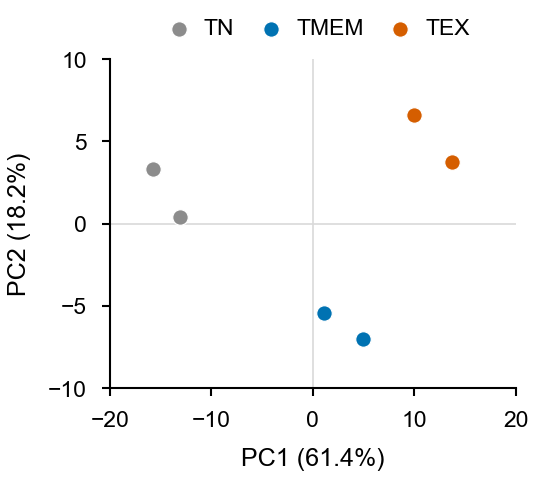
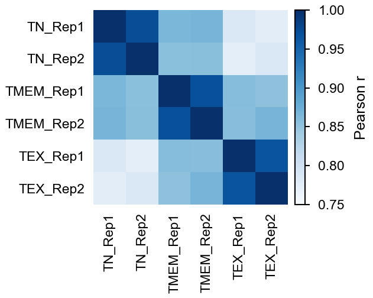
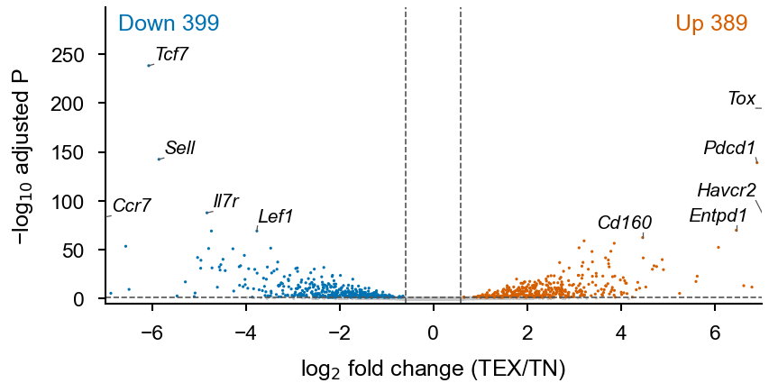
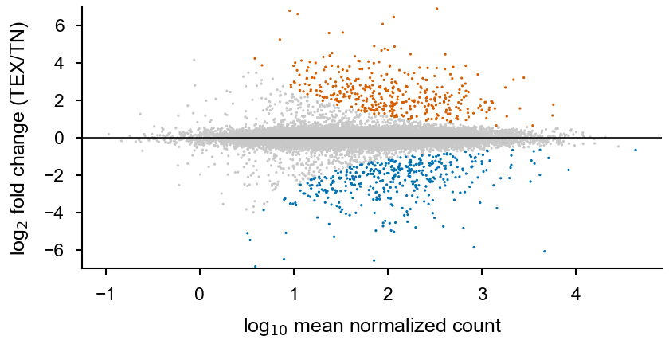
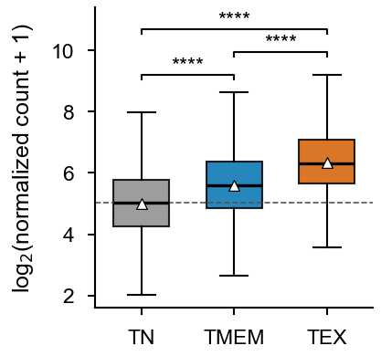

# Part 5 · Read counting and differential peak analysis

[← Peak calling](04_peak_calling.md) · [Index](../README.md) · [Next: Annotation & enrichment →](06_annotation_enrichment.md)

| Step | Input | Output |
|---|---|---|
| Count fragments per peak | union peaks (BED6) + dedup BAMs | `RawRC_<prefix>.txt` |
| DESeq2 | raw counts + `SampleID_<prefix>.txt` | `deseq2_<prefix>.txt`, `NormRC_<prefix>_wID.txt` |
| Plots | normalized counts / results | PCA, correlation, MA, volcano, box plots |

---

## 5.1 Count reads under peaks

**Method 1 – `bedtools multicov`** (simple; counts *reads*)

```bash
bams=$(ls BAM/*H3K27ac*.map.dedup.bam | sort)
names=$(for b in ${bams}; do basename ${b} .map.dedup.bam; done | paste -sd'\t')

bsub -n 4 -M 32000 -e Log/multicov.e -o Log/multicov.o \
  "bedtools multicov -bed Peak/peak_Union_H3K27ac.bed6.bed -bams ${bams} > ReadCount/RawRC_multicov.bed"

# add a header: 6 peak columns + one column per sample
sed "1i Chr\tStart\tEnd\tpeakN\tScore\tStrand\t${names}" ReadCount/RawRC_multicov.bed \
  > ReadCount/RawRC_H3K27ac.txt
```

**Method 2 – `featureCounts`** (fast, multithreaded; counts *fragments* for PE data)

```bash
FC=/path/to/tools/subread-2.0.1-Linux-x86_64/bin/featureCounts

# SAF = GeneID  Chr  Start(1-based)  End  Strand
awk 'BEGIN{OFS="\t"; print "GeneID","Chr","Start","End","Strand"}
     {print $4,$1,$2+1,$3,"."}' Peak/peak_Union_H3K27ac.bed6.bed > Peak/peak_Union_H3K27ac.saf

bsub -n 8 -M 32000 -e Log/fc.e -o Log/fc.o \
  ${FC} -T 8 -p --countReadPairs -F SAF \
        -a Peak/peak_Union_H3K27ac.saf \
        -o ReadCount/RawRC_H3K27ac_featureCounts.txt BAM/*H3K27ac*.map.dedup.bam
```

> Since subread 2.0.2, `-p` only says the data are paired; add `--countReadPairs` to count fragments. BED starts are 0-based and SAF starts are 1-based, hence `$2+1`.

Example `RawRC_H3K27ac_featureCounts.txt.summary` (illustrative):

```text
Status                    TN_Rep1   TN_Rep2   TMEM_Rep1 ...
Assigned                  3512448   3301876   4123004
Unassigned_NoFeatures     8401221   7953114   8810542
```

Assigned ÷ (Assigned + NoFeatures) is the FRiP of each library.

---

## 5.2 DESeq2 on peak counts

Sample sheet `SampleID_H3K27ac.txt`. List the reference condition **first**, because factor levels follow file order:

```text
sampleID     Condition
TN_Rep1      TN
TN_Rep2      TN
TEX_Rep1     TEX
TEX_Rep2     TEX
```

```r
## deseq2_peaks.R — differential peaks for one 2-group comparison
suppressPackageStartupMessages({
  library(data.table); library(dplyr); library(DESeq2)
})

prefix <- "H3K27ac"
meta   <- fread(paste0("SampleID_", prefix, ".txt"))
RawRC  <- fread(paste0("RawRC_",   prefix, ".txt")) |> as.data.frame()

## featureCounts output: rename columns to sample IDs
# RawRC <- fread(file, skip = 1) |> rename(peakN = Geneid)
# colnames(RawRC) <- sub(".map.dedup.bam$", "", basename(colnames(RawRC)))

infocol  <- c("peakN", "Chr", "Start", "End")
peak_df  <- RawRC[, infocol]
cnt      <- as.matrix(RawRC[, meta$sampleID])
rownames(cnt) <- RawRC$peakN

## design
coldata <- data.frame(row.names = meta$sampleID,
                      Condition = factor(meta$Condition, levels = unique(meta$Condition)))
comps <- levels(coldata$Condition)            # comps[1] = reference

## remove peaks with almost no signal
MAX  <- apply(cnt, 1, max)
SUM  <- rowSums(cnt)
keep <- MAX >= max(5, quantile(MAX, 0.01)) & SUM >= quantile(SUM, 0.01)
cnt_f <- cnt[keep, ]
message(sum(!keep), " of ", nrow(cnt), " peaks removed by the low-count filter")

## DESeq2
dds <- DESeqDataSetFromMatrix(cnt_f, colData = coldata, design = ~ Condition)
dds <- DESeq(dds)
res <- results(dds, contrast = c("Condition", comps[2], comps[1]), pAdjustMethod = "fdr")
summary(res)
saveRDS(dds, paste0("obj_deseq2_", prefix, ".rds"))

res_out <- as.data.frame(res) |>
  mutate(peakN = rownames(res),
         across(c(log2FoldChange, lfcSE, stat), ~ round(.x, 4)),
         dir     = ifelse(log2FoldChange > 0, 1, -1),
         compare = paste0(comps[2], "_vs_", comps[1]),
         Sig.Dir = case_when(padj < 0.05 & log2FoldChange >  log2(1.5) ~  1,
                             padj < 0.05 & log2FoldChange < -log2(1.5) ~ -1,
                             TRUE ~ 0)) |>
  inner_join(peak_df, by = "peakN") |>
  relocate(peakN, Chr, Start, End) |>
  arrange(padj, desc(abs(log2FoldChange)))
fwrite(res_out, paste0("deseq2_", prefix, ".txt"), sep = "\t")

## normalized counts (for heatmaps / box plots)
NormRC <- round(counts(dds, normalized = TRUE), 2) |> as.data.frame()
NormRC <- peak_df |> inner_join(data.frame(peakN = rownames(NormRC), NormRC), by = "peakN")
fwrite(NormRC, paste0("NormRC_", prefix, "_wID.txt"), sep = "\t")

fwrite(data.frame(sampleID = colnames(dds), sizeFactor = sizeFactors(dds)),
       paste0("scale_DESeq2_", prefix, ".txt"), sep = "\t")
fwrite(peak_df[!keep, ], paste0("peak_Union_", prefix, ".removed1.txt"), sep = "\t")
```

> Outputs: `deseq2_<prefix>.txt` (results with coordinates), `NormRC_<prefix>_wID.txt` (normalized counts), `scale_DESeq2_<prefix>.txt` (size factors), `obj_deseq2_<prefix>.rds` (DESeq2 object; reload with `readRDS`) and the list of peaks removed by the low-count filter.

Example `summary(res)` (illustrative):

```text
out of 41236 with nonzero total read count
adjusted p-value < 0.1
LFC > 0 (up)       : 2318, 5.6%
LFC < 0 (down)     : 2104, 5.1%
outliers [1]       : 0, 0%
low counts [2]     : 0, 0%
```

**More than two groups.** Fit once and pull every contrast:

```r
pairs <- list(c("TMEM","TN"), c("TEX","TN"), c("TEX","TMEM"))
res_all <- lapply(pairs, \(p) results(dds, contrast = c("Condition", p[1], p[2])))
names(res_all) <- sapply(pairs, paste, collapse = "_vs_")
```

**Batch / replicate effects.** Add the batch to the design: `design = ~ batch + Condition`.

---

## 5.3 Plot functions (Nature style)

A small plotting library with a shared publication theme. Save the blocks below as `Code/plot_funcs.R` and load it with `source("Code/plot_funcs.R")`.

```r
library(ggplot2); library(ggrepel); library(pheatmap); library(RColorBrewer)

theme_nature <- function(base = 7) {
  theme_classic(base_size = base, base_family = "Helvetica") +
  theme(axis.line  = element_line(linewidth = 0.25),
        axis.ticks = element_line(linewidth = 0.25),
        axis.text  = element_text(colour = "black"),
        legend.key.size = unit(3, "mm"),
        plot.title = element_text(size = base, face = "plain", hjust = 0.5))
}
cond_cols <- c(TN = "#8C8C8C", TMEM = "#0072B2", TEX = "#D55E00")   # Okabe–Ito
save_fig  <- function(p, f, w = 89, h = 70)                         # mm; 89 = 1 col, 183 = 2 col
  ggsave(f, p, width = w, height = h, units = "mm", device = cairo_pdf)
```

### PCA

```r
plotpca <- function(mat, condition, name, colorset = cond_cols, ntop = 5000) {
  v   <- apply(mat, 1, var)
  top <- head(order(v, decreasing = TRUE), ntop)        # most variable peaks
  pc  <- prcomp(t(log2(mat[top, ] + 1)))
  ve  <- round(100 * summary(pc)$importance[2, 1:2], 1)
  df  <- data.frame(pc$x[, 1:2], condition = condition, sample = colnames(mat))
  p <- ggplot(df, aes(PC1, PC2, colour = condition)) +
    geom_hline(yintercept = 0, colour = "grey85", linewidth = 0.2) +
    geom_vline(xintercept = 0, colour = "grey85", linewidth = 0.2) +
    geom_point(size = 2) +
    scale_colour_manual(values = colorset) +
    labs(x = paste0("PC1 (", ve[1], "%)"), y = paste0("PC2 (", ve[2], "%)"), colour = NULL) +
    theme_nature()
  save_fig(p, paste0("plot_PCA_", name, ".pdf"), w = 60, h = 50)
  p
}
```



**[Fig. 5.1](figures/part05_pca.pdf) | PCA of samples.** PCA of log-transformed normalized counts at the 5,000 most variable peaks; replicates cluster by condition. *Simulated data.*

(DESeq2 alternative: `plotPCA(vst(dds), intgroup = "Condition")`. Log transformation or VST stops a few very strong peaks from dominating the PCs.)

For colour + shape by guide and PC2/PC3 plots, see [part 16](16_pca_plot.md).

### Sample correlation heatmap

```r
plotcorr <- function(mat, condition, name, colorset = cond_cols) {
  r   <- cor(log2(mat + 1), method = "pearson")
  ann <- data.frame(Condition = condition, row.names = colnames(mat))
  pheatmap(r, border_color = NA, fontsize = 7,
           color = colorRampPalette(brewer.pal(9, "Blues"))(100),
           annotation_col = ann, annotation_row = ann,
           annotation_colors = list(Condition = colorset),
           cellwidth = 12, cellheight = 12,
           filename = paste0("plot_Corr_", name, ".pdf"))
}
```



**[Fig. 5.2](figures/part05_correlation.pdf) | Sample correlation.** Pearson correlation between samples on log-transformed normalized counts. *Simulated data.*

### MA and volcano plots

```r
plotvol <- function(res, name, fc = 1.5, alpha = 0.05, label_top = 10, label_col = "Gene.Name") {
  res <- res |> filter(!is.na(padj)) |>
    mutate(Sig = case_when(padj < alpha & log2FoldChange >  log2(fc) ~ "Up",
                           padj < alpha & log2FoldChange < -log2(fc) ~ "Down",
                           TRUE ~ "NS")) |>
    arrange(padj)
  n  <- table(factor(res$Sig, levels = c("Down", "Up")))
  lab <- res |> filter(Sig != "NS") |> group_by(Sig) |> slice_head(n = label_top / 2)

  p <- ggplot(res, aes(log2FoldChange, -log10(padj), colour = Sig)) +
    geom_point(size = 0.3, stroke = 0) +
    scale_colour_manual(values = c(Down = "#0072B2", NS = "grey80", Up = "#D55E00")) +
    geom_vline(xintercept = c(-1, 1) * log2(fc), linetype = 2, linewidth = 0.2) +
    geom_hline(yintercept = -log10(alpha),      linetype = 2, linewidth = 0.2) +
    geom_text_repel(data = lab, aes(label = .data[[label_col]]), size = 2,
                    fontface = "italic", colour = "black", segment.size = 0.2, max.overlaps = Inf) +
    annotate("text", x = -Inf, y = Inf, hjust = -0.1, vjust = 1.2, size = 2.3,
             colour = "#0072B2", label = paste("Down", n["Down"])) +
    annotate("text", x =  Inf, y = Inf, hjust = 1.1, vjust = 1.2, size = 2.3,
             colour = "#D55E00", label = paste("Up", n["Up"])) +
    labs(x = expression(log[2]~fold~change), y = expression(-log[10]~adjusted~italic(P))) +
    theme_nature() + theme(legend.position = "none")
  save_fig(p, paste0("plot_Volcano_", name, ".pdf"), w = 60, h = 60)
  p
}
```



**[Fig. 5.3](figures/part05_volcano.pdf) | Volcano plot.** TEX versus TN (DESeq2). Coloured points, FDR < 0.05 and |fold change| > 1.5 (dashed lines); the most significant loci are labelled and the numbers of up and down peaks are shown at the top. *Simulated data.*

```r
# MA plot straight from DESeq2
pdf("plot_MA_H3K27ac.pdf", width = 2.4, height = 2.2, pointsize = 7)
plotMA(res, ylim = c(-6, 6), alpha = 0.05, colSig = "#D55E00")
dev.off()
```



**[Fig. 5.4](figures/part05_ma.pdf) | MA plot.** Log₂ fold change (TEX/TN) against mean normalized count; coloured points have FDR < 0.05 and |fold change| > 1.5. *Simulated data.*

### Box plot with Wilcoxon P values

```r
library(ggpubr); library(tidyr); library(stringr)

NormRC <- fread("NormRC_H3K27ac_wID.txt")
long <- NormRC |>
  pivot_longer(-c(peakN, Chr, Start, End), names_to = "sampleID", values_to = "NormRC") |>
  mutate(Cond = factor(str_split_i(sampleID, "_", 1), levels = names(cond_cols)),
         Rep  = str_split_i(sampleID, "_", 2))

med_ref <- median(log2(long$NormRC[long$Cond == "TN"] + 1))
comps   <- list(c("TN", "TMEM"), c("TN", "TEX"), c("TMEM", "TEX"))

p <- ggplot(long, aes(Cond, log2(NormRC + 1), fill = Cond)) +
  geom_boxplot(width = 0.6, outlier.shape = NA, linewidth = 0.25) +
  stat_summary(fun = mean, geom = "point", shape = 17, colour = "white", size = 1) +
  geom_hline(yintercept = med_ref, linetype = 2, linewidth = 0.2) +
  stat_compare_means(comparisons = comps, method = "wilcox.test",
                     label = "p.signif", size = 2.2, tip.length = 0.01) +
  scale_fill_manual(values = cond_cols) +
  labs(x = NULL, y = expression(log[2]*"(normalized count + 1)")) +
  theme_nature() + theme(legend.position = "none")
save_fig(p, "p_box_NormRC_H3K27ac.pdf", w = 45, h = 55)
```



**[Fig. 5.5](figures/part05_boxplot.pdf) | Signal at differential regions.** Normalized H3K27ac signal at differential regions across conditions. Box, interquartile range; centre line, median; triangle, mean; whiskers, 1.5× IQR. Dashed line, TN median. Two-sided Wilcoxon rank-sum test; \*\*\*\**P* < 10⁻⁴. *Simulated data.*

> With thousands of peaks, almost any shift gives *P* < 10⁻⁴. Report the effect size (median difference) next to the *P* value, and state the test and *n* in the legend.

### Pie or bar of up/down counts

For publication, a single stacked bar with labelled counts is easier to read than pie charts:

```r
cnt <- res_out |> count(Sig.Dir) |>
  mutate(Class = factor(c(`-1` = "Down", `0` = "NS", `1` = "Up")[as.character(Sig.Dir)],
                        levels = c("Up", "Down", "NS")))
ggplot(cnt, aes(x = "", y = n, fill = Class)) + geom_col(width = 0.6) +
  scale_fill_manual(values = c(Up = "#D55E00", Down = "#0072B2", NS = "grey85")) +
  coord_flip() + labs(x = NULL, y = "Peaks") + theme_nature()
```

### PCA by hand (loadings)

```r
pc <- prcomp(t(log2(mat + 1)), scale. = FALSE)
summary(pc)$importance[2, 1:5]                         # variance explained
# peaks/genes driving PC1 (largest positive and negative loadings)
head(sort(pc$rotation[, 1], decreasing = TRUE), 30)
head(sort(pc$rotation[, 1]), 30)
```

---

## References and resources

- Love, M. I., Huber, W. & Anders, S. Moderated estimation of fold change and dispersion for RNA-seq data with DESeq2. *Genome Biol.* **15**, 550 (2014). — <https://bioconductor.org/packages/DESeq2>
- Liao, Y., Smyth, G. K. & Shi, W. featureCounts: an efficient general purpose program for assigning sequence reads to genomic features. *Bioinformatics* **30**, 923–930 (2014). — <https://subread.sourceforge.net>
- Ross-Innes, C. S. *et al.* Differential oestrogen receptor binding is associated with clinical outcome in breast cancer. *Nature* **481**, 389–393 (2012). (DiffBind, an alternative for peak data)
- ggplot2 — <https://ggplot2.tidyverse.org>; ggrepel — <https://ggrepel.slowkow.com>; ggpubr — <https://rpkgs.datanovia.com/ggpubr/>
- Okabe, M. & Ito, K. Color Universal Design (colour-blind-safe palette) — <https://jfly.uni-koeln.de/color/>
- *Nature* figure preparation guidelines — <https://www.nature.com/nature/for-authors/final-submission>

---

[← Peak calling](04_peak_calling.md) · [Index](../README.md) · [Next: Annotation & enrichment →](06_annotation_enrichment.md)
