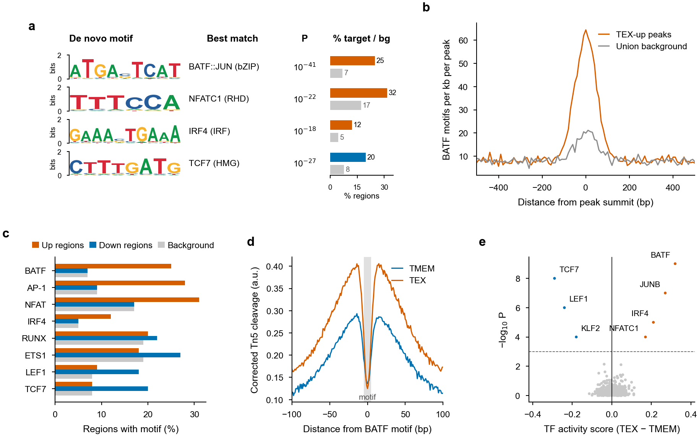
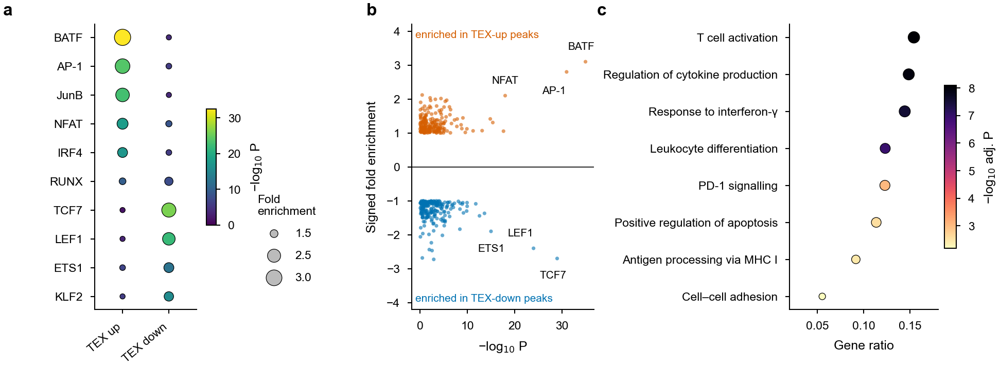

# 7 · Motif enrichment, footprinting and TF–gene networks

[← Annotation & enrichment](06_annotation_enrichment.md) · [Index](../README.md) · [Next: Visualization →](08_visualization.md)

**Background choice matters more than the tool.** To find motifs specific to differential regions, compare them against the **union of all peaks for the same mark**, not the whole genome. Otherwise the top hits are generic open-chromatin or promoter motifs.

---

## 7.1 HOMER `findMotifsGenome.pl`

```bash
export PATH=$PATH:/path/to/tools/homer/bin
species=mm10
union=Peak/peak_Union_H3K27ac.bed6.bed               # background

for dir in Up Down; do
  input=DESeq2/deseq2_Sig_${dir}.bed6.bed            # chr start end ID . strand
  out=Motif/homer_Sig_${dir}_bcUnion
  bsub -n 8 -M 64000 -e Log/homer_${dir}.e -o Log/homer_${dir}.o \
    findMotifsGenome.pl ${input} ${species} ${out} \
      -size given -mask -p 8 -bg ${union} -preparsedDir Motif/preparsed
done
```

| Option | Meaning |
|---|---|
| `-size given` | use the full peak (broad marks); `-size 200` centres a 200-bp window on the peak (TFs / ATAC) |
| `-mask` | use the repeat-masked genome |
| `-bg` | custom background regions |
| `-p` | threads; match `bsub -n` |
| `-preparsedDir` | writable cache folder (HOMER's install directory is often read-only) |
| `-nomotif` | known motifs only (much faster) |

Output: `knownResults.txt` (known motifs), `homerResults.html` (de novo motifs) and logo folders.

Example `knownResults.txt` (illustrative, first columns):

```text
Motif Name                                 Consensus     P-value  Log P-value  q-value  % Target  % Background
BATF(bZIP)/Th17-BATF-ChIP-Seq/Homer        DATGASTCAT    1e-35    -8.1e+01     0.0000   21.4%     7.0%
Atf3(bZIP)/GBM-ATF3-ChIP-Seq/Homer         DATGASTCATHN  1e-31    -7.2e+01     0.0000   24.9%     9.1%
```

> HOMER's `Log P-value` is a **natural** log. Convert with `log10P = LogP / log(10)`. Do not use `log10(exp(LogP))`, which underflows to −∞ for strong motifs.

### Archive motif folders

The logo folders hold thousands of small files, which strains cluster quotas:

```bash
find Motif -maxdepth 1 -type d -name "homer_*" | while read d; do
  ( cd "$d" && tar -czf homerResults.tar.gz homerResults && tar -czf knownResults.tar.gz knownResults \
            && rm -rf homerResults knownResults )
done
```

---

## 7.2 MEME suite: AME (enrichment) and FIMO (sites)

```bash
export PATH=$PATH:/path/to/tools/meme-5.1.0/bin
REF=/path/to/indexes/mm10/mm10.fa
DB=motif_db/merge_Homer_CISBP_Jaspar.meme       # MEME-format motif database(s)

# FASTA for targets and background (soft-masked repeats are lowercase)
bedtools getfasta -fi ${REF} -bed target.bed -fo target.fa
bedtools getfasta -fi ${REF} -bed union.bed  -fo background.fa
# optional hard masking: RepeatMasker target.fa -species mammal  → target.fa.masked

# AME vs shuffled control …
ame --oc ame_target_bcShuffle --scoring avg --method fisher \
    --control --shuffle-- --seed 123 target.fa ${DB}
# … or vs the peak background
ame --oc ame_target_bcUnion   --scoring avg --method fisher \
    --control background.fa target.fa ${DB}

# FIMO: individual motif occurrences (q-values reported)
fimo --oc fimo_target --bfile --motif-- --thresh 1e-4 ${DB} target.fa
```

---

## 7.3 Plot HOMER results

### Merge several comparisons

```r
library(data.table); library(dplyr); library(ggplot2); library(ggrepel)

read_homer <- function(f, label) {
  fread(f) |> as.data.frame() |>
    select(1:5, 7, 9) |>
    setNames(c("Motif.Name", "Consensus", "P.value", "Log.P.value", "q.value",
               "Target_Perc", "Background_Perc")) |>
    mutate(Target_Perc     = as.numeric(sub("%", "", Target_Perc)),
           Background_Perc = as.numeric(sub("%", "", Background_Perc)),
           FC        = Target_Perc / Background_Perc,
           log10P    = -Log.P.value / log(10),                # positive −log10 P
           Motif     = sub("\\(.*", "", Motif.Name),          # "BATF(bZIP)/…" → "BATF"
           Compare   = label)
}

M <- bind_rows(read_homer("Motif/homer_Sig_Up_bcUnion/knownResults.txt",   "TEX up"),
               read_homer("Motif/homer_Sig_Down_bcUnion/knownResults.txt", "TEX down"))
fwrite(M, "Merge_knownMotifs.csv")
```

### Dot plot of top motifs per comparison

```r
top <- M |> group_by(Compare) |> filter(q.value < 0.05) |> slice_max(FC, n = 5) |> pull(Motif) |> unique()
d   <- M |> filter(Motif %in% top) |> mutate(Motif = factor(Motif, levels = rev(top)))

p <- ggplot(d, aes(Compare, Motif, size = FC, colour = log10P)) +
  geom_point() +
  scale_size_continuous(name = "Fold\nenrichment", range = c(0.5, 4)) +
  scale_colour_viridis_c(name = expression(-log[10]~italic(P))) +
  labs(x = NULL, y = NULL) + theme_nature() +
  theme(axis.text.x = element_text(angle = 45, hjust = 1))
ggsave("p_dot_knownMotifs_top5.pdf", p, width = 60, height = 70, units = "mm")
```

### Pairwise (signed) motif plot

```r
P <- M |> mutate(FC.dir = ifelse(Compare == "TEX up", FC, -FC)) |> filter(P.value < 1)
lab <- P |> filter(q.value < 0.01 & FC > 2)

p <- ggplot(P, aes(log10P, FC.dir, colour = Compare)) +
  geom_hline(yintercept = 0, linewidth = 0.25) +
  geom_point(size = 0.6, alpha = 0.6) +
  geom_text_repel(data = lab, aes(label = Motif), size = 2, max.overlaps = 15, segment.size = 0.2) +
  scale_colour_manual(values = c(`TEX up` = "#D55E00", `TEX down` = "#0072B2")) +
  labs(x = expression(-log[10]~italic(P)), y = "Signed fold enrichment") +
  theme_nature() + theme(legend.position = "none")
ggsave("p_pairwise_knownMotifs.pdf", p, width = 80, height = 70, units = "mm")
```

### Publication sequence logos (de novo motifs)

HOMER writes each de novo motif as `homerResults/motifN.motif`: a header line, then one row of A/C/G/T probabilities per position.

```r
library(ggseqlogo)

read_homer_motif <- function(f) {
  m <- as.matrix(read.table(f, skip = 1))
  dimnames(m) <- list(NULL, c("A", "C", "G", "T"))
  t(m)                                               # ggseqlogo wants bases × positions
}
dir  <- "Motif/homer_Sig_Up_bcUnion/homerResults"
pwms <- lapply(sprintf("%s/motif%d.motif", dir, 1:4), read_homer_motif)
names(pwms) <- sapply(sprintf("%s/motif%d.motif", dir, 1:4),
                      \(f) strsplit(readLines(f, 1), "\t")[[1]][2])   # "BestGuess:…" name

p <- ggseqlogo(pwms, method = "bits", ncol = 1) + theme_nature() +
     theme(strip.text = element_text(size = 6, hjust = 0))
ggsave("p_logos_denovo_up.pdf", p, width = 60, height = 80, units = "mm")
```

The best-match name, *P* value and % target/background for each motif are in the header line and in `homerResults.html`.

### % of regions with each motif

```r
sel <- c("BATF", "AP-1", "NFAT", "IRF4", "RUNX", "ETS1", "LEF1", "TCF7")
d <- M |> filter(Motif %in% sel) |>
  select(Motif, Compare, Target_Perc, Background_Perc) |>
  tidyr::pivot_wider(names_from = Compare, values_from = Target_Perc) |>
  group_by(Motif) |> summarise(across(everything(), \(x) max(x, na.rm = TRUE))) |>
  tidyr::pivot_longer(-Motif, names_to = "Set", values_to = "Pct") |>
  mutate(Set = recode(Set, Background_Perc = "Background"),
         Motif = factor(Motif, levels = rev(sel)))

ggplot(d, aes(Pct, Motif, fill = Set)) +
  geom_col(position = position_dodge(0.8), width = 0.75) +
  scale_fill_manual(values = c(`TEX up` = "#D55E00", `TEX down` = "#0072B2", Background = "grey80")) +
  labs(x = "Regions with motif (%)", y = NULL, fill = NULL) + theme_nature()
```

### Motif position relative to peak centres

A real TF motif should be concentrated at peak centres (summits); a motif that is flat across the window is usually background sequence composition.

```bash
# motif density histogram ±500 bp around peak centres, 10-bp bins
annotatePeaks.pl DESeq2/deseq2_Sig_Up.bed6.bed mm10 -size 1000 -hist 10 \
  -m Motif/homer_Sig_Up_bcUnion/knownResults/known1.motif > Motif/hist_BATF_up.txt
annotatePeaks.pl Peak/peak_Union_H3K27ac.bed6.bed mm10 -size 1000 -hist 10 \
  -m Motif/homer_Sig_Up_bcUnion/knownResults/known1.motif > Motif/hist_BATF_union.txt
```

```r
h <- bind_rows(
  `TEX-up peaks`     = fread("Motif/hist_BATF_up.txt"),
  `Union background` = fread("Motif/hist_BATF_union.txt"), .id = "Set") |>
  select(Set, Distance = 2, Density = 3)        # after Set: col 1 = distance from centre, col 2 = motif sites per bp per peak

ggplot(h, aes(Distance, Density * 1000, colour = Set)) + geom_line(linewidth = 0.4) +
  scale_colour_manual(values = c(`TEX-up peaks` = "#D55E00", `Union background` = "grey55")) +
  labs(x = "Distance from peak centre (bp)", y = "Motifs per kb per peak", colour = NULL) +
  theme_nature()
```

(For MACS2 narrow peaks, centre the regions on the summit first: `awk 'BEGIN{OFS="\t"}{s=$2+$10; print $1,s,s+1,$4,".","+"}' peaks.narrowPeak`.)

---

## 7.4 TF footprinting with HINT (RGT)

HINT finds protected TF footprints inside accessible regions, correcting for Tn5/DNase cleavage bias.

```bash
# 1. footprints per condition (paired-end ATAC)
rgt-hint footprinting --atac-seq --paired-end --organism=mm10 \
  --output-location=HINT --output-prefix=TEX  TEX.bam  TEX_peaks.narrowPeak
rgt-hint footprinting --atac-seq --paired-end --organism=mm10 \
  --output-location=HINT --output-prefix=TMEM TMEM.bam TMEM_peaks.narrowPeak

# 2. motif-predicted binding sites inside footprints (JASPAR by default)
rgt-motifanalysis matching --organism=mm10 --input-files HINT/TEX.bed HINT/TMEM.bed
#   custom PWMs: --motif-dbs /path/to/pwm_dir

# 3. differential TF activity from bias-corrected cleavage profiles
rgt-hint differential --organism=mm10 --bc --nc 20 \
  --mpbs-files=match/TEX_mpbs.bed,match/TMEM_mpbs.bed \
  --reads-files=TEX.bam,TMEM.bam --conditions=TEX,TMEM \
  --output-location=HINT/TEX_vs_TMEM
```

**Outputs of `rgt-hint differential`:** a statistics table (one row per motif with a TF-activity difference and *P* value) and one line plot per motif showing the bias-corrected cleavage profile in both conditions.

Volcano of differential TF activity (column names can differ between RGT versions; check the header first):

```r
st <- fread("HINT/TEX_vs_TMEM/differential_statistics.txt")
lab <- st |> filter(P_values < 1e-3)
ggplot(st, aes(TF_Activity, -log10(P_values))) +
  geom_point(aes(colour = ifelse(P_values < 1e-3, sign(TF_Activity), 0)), size = 0.5) +
  scale_colour_gradient2(low = "#0072B2", mid = "grey80", high = "#D55E00", guide = "none") +
  geom_hline(yintercept = 3, linetype = 2, linewidth = 0.2) +
  ggrepel::geom_text_repel(data = lab, aes(label = Motif), size = 2, segment.size = 0.2) +
  labs(x = "TF activity score (TEX − TMEM)", y = expression(-log[10]~italic(P))) + theme_nature()
```

Custom footprint profiles: write bias-corrected signal as bigWig, then aggregate it at the motif-matched sites with deepTools:

```bash
rgt-hint tracks --bc --bigWig --organism=mm10 --output-prefix=TEX_bc  TEX.bam  TEX_peaks.narrowPeak
rgt-hint tracks --bc --bigWig --organism=mm10 --output-prefix=TMEM_bc TMEM.bam TMEM_peaks.narrowPeak
grep -w BATF match/TEX_mpbs.bed > BATF_sites.bed
computeMatrix reference-point --referencePoint center -S TMEM_bc.bw TEX_bc.bw \
  -R BATF_sites.bed -a 100 -b 100 --binSize 1 -o BATF_footprint.mat.gz
plotProfile -m BATF_footprint.mat.gz --perGroup --colors "#0072B2" "#D55E00" -out BATF_footprint.pdf
```

For single-end ATAC drop `--paired-end`. For DNase-seq use `--dnase-seq`; for histone CUT&RUN/ChIP use `--histone`.

---

## 7.5 TF → target-gene networks for Cytoscape

From a two-column table (TF, target gene; e.g. motif hits in super-enhancers linked to genes), make a node/edge file with node degrees:

```r
library(data.table); library(dplyr)

tf_gene <- fread("SE_TEXonly_TF_IRF1_binding_genes.simp.txt", header = FALSE,
                 col.names = c("TF", "Gene"))

to_cytoscape <- function(df, name) {
  out <- df |> distinct() |>
    add_count(TF,   name = "TF.degree") |>
    add_count(Gene, name = "Gene.degree") |>
    mutate(Gene.Dir = 1)
  fwrite(out, paste0("forCyto_", name, ".txt"), sep = "\t")
  out
}
to_cytoscape(tf_gene, "IRF1_map_SE_DiffGenes")
```

Shell step that produced the input (peak names encode `..._<gene>`):

```bash
grep SE SE_TEXonly_TF_IRF1_binding_genes.peakNames.txt \
  | sed 's/_/\t/g' | awk 'BEGIN{OFS="\t"} {print "IRF1",$6}' | sort -u \
  > SE_TEXonly_TF_IRF1_binding_genes.simp.txt
```

In Cytoscape: *File → Import → Network from File*, with source = `TF` and target = `Gene`. Map node size to degree.

---

## Example output



**Fig. 10 | Motif analysis results.** **a**, Top HOMER de novo motifs from TEX-gained (orange) and TEX-lost (blue) H3K27ac regions: sequence logo (information content, bits), best-matching known motif, enrichment *P* value, and percentage of target regions versus background regions containing the motif. **b**, BATF motif density around peak centres (`annotatePeaks.pl -hist`): sharply centred enrichment in TEX-gained peaks compared with the union background. **c**, Percentage of TEX-up, TEX-down and background regions containing each motif. **d**, HINT bias-corrected Tn5 cleavage around BATF motif sites; increased flanking accessibility and a deeper central dip (footprint) in TEX indicate greater BATF occupancy. **e**, HINT differential TF activity (TEX − TMEM) against significance; dashed line, *P* = 10⁻³. *Simulated data for illustration.*



**Fig. 6 | Motif enrichment at differential H3K27ac regions.** **a**, HOMER known motifs enriched in TEX-gained (up) or TEX-lost (down) regions against the union-peak background; dot size, fold enrichment over background; colour, −log₁₀ *P*. **b**, All known motifs plotted as signed fold enrichment (positive = up regions, negative = down regions) against significance; the strongest motifs are labelled. **c**, see chapter 6. *Simulated data for illustration.*

---

## References and resources

- Heinz, S. *et al.* *Mol. Cell* **38**, 576–589 (2010). (HOMER motif analysis) — <http://homer.ucsd.edu/homer/motif/>
- Bailey, T. L., Johnson, J., Grant, C. E. & Noble, W. S. The MEME Suite. *Nucleic Acids Res.* **43**, W39–W49 (2015). — <https://meme-suite.org>
- McLeay, R. C. & Bailey, T. L. Motif Enrichment Analysis: a unified framework and an evaluation on ChIP data. *BMC Bioinformatics* **11**, 165 (2010). (AME)
- Grant, C. E., Bailey, T. L. & Noble, W. S. FIMO: scanning for occurrences of a given motif. *Bioinformatics* **27**, 1017–1018 (2011).
- Li, Z. *et al.* Identification of transcription factor binding sites using ATAC-seq. *Genome Biol.* **20**, 45 (2019). (HINT-ATAC) — <https://www.regulatory-genomics.org/hint/>
- Castro-Mondragon, J. A. *et al.* JASPAR 2022. *Nucleic Acids Res.* **50**, D165–D173 (2022). — <https://jaspar.elixir.no>
- Wagih, O. ggseqlogo: a versatile R package for drawing sequence logos. *Bioinformatics* **33**, 3645–3647 (2017).
- Shannon, P. *et al.* Cytoscape: a software environment for integrated models of biomolecular interaction networks. *Genome Res.* **13**, 2498–2504 (2003). — <https://cytoscape.org>

---

[← Annotation & enrichment](06_annotation_enrichment.md) · [Index](../README.md) · [Next: Visualization →](08_visualization.md)
