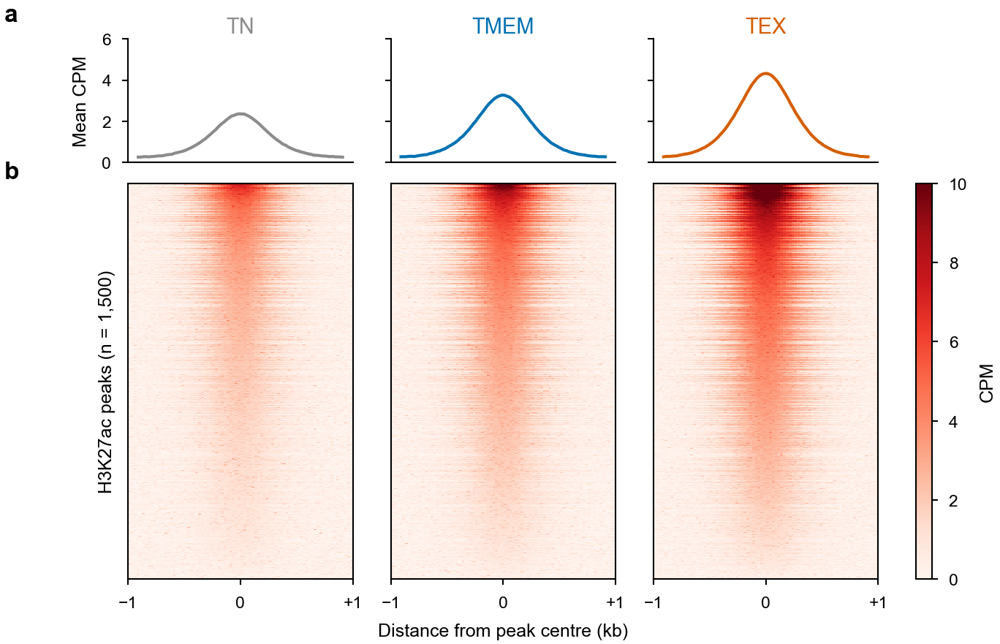
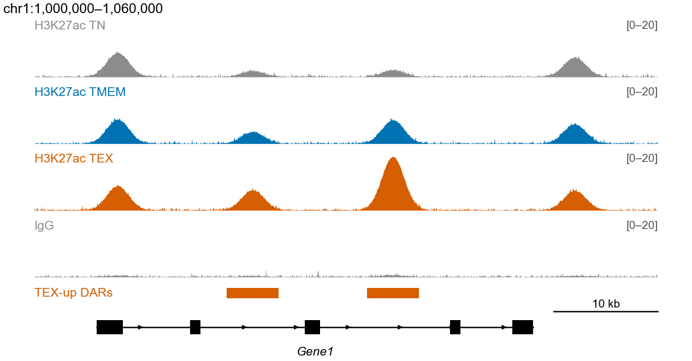

# 8 · Signal visualization: heatmaps, pooled tracks, genome browser

[← Motif analysis](07_motif_analysis.md) · [Index](../README.md) · [Next: RNA-seq →](09_rnaseq.md)

---

## 8.1 deepTools profile + heatmap

Put all samples into **one matrix** so they share a row order and colour scale, which is what a figure needs:

```bash
bws="Wig/pool_TN_H3K27ac.bw Wig/pool_TMEM_H3K27ac.bw Wig/pool_TEX_H3K27ac.bw"
labels="TN TMEM TEX"
regions=Peak/peak_Union_H3K27ac.bed6.bed

computeMatrix reference-point --referencePoint center \
  -S ${bws} --samplesLabel ${labels} \
  -R ${regions} -a 1000 -b 1000 --binSize 25 \
  --skipZeros --missingDataAsZero -p 8 \
  -o H3K27ac_union_center.mat.gz

plotHeatmap -m H3K27ac_union_center.mat.gz \
  --sortRegions descend --sortUsing mean \
  --colorMap Reds --zMin 0 --zMax 10 \
  --refPointLabel "Center" --regionsLabel "H3K27ac peaks" \
  --heatmapHeight 12 --heatmapWidth 3 \
  --legendLocation none --dpi 300 \
  -out H3K27ac_union_center_heatmap.pdf

# profile only
plotProfile -m H3K27ac_union_center.mat.gz --perGroup --colors "#8C8C8C" "#0072B2" "#D55E00" \
  -out H3K27ac_union_center_profile.pdf
```

Useful variants:

| Goal | Change |
|---|---|
| Up vs Down groups | `-R up.bed down.bed` (each file becomes a group) |
| Unsupervised groups | `plotHeatmap --kmeans 4 --outFileSortedRegions clusters.bed` |
| Gene bodies | `computeMatrix scale-regions -R genes.bed -b 3000 -a 3000 --regionBodyLength 5000` |
| Keep input order | `--sortRegions no` |

---

## 8.2 Pool replicates into one track

Average replicates (keeps the CPM scale) instead of summing them:

```bash
# deepTools ≥ 3.5.2
bigwigAverage -b Wig/TEX_H3K27ac_Rep1.cpm.bw Wig/TEX_H3K27ac_Rep2.cpm.bw \
  --binSize 10 -p 8 -o Wig/pool_TEX_H3K27ac.bw

# WiggleTools + UCSC
wiggletools write_bg pool_TEX.bedgraph mean Wig/TEX_H3K27ac_Rep*.cpm.bw
sort -k1,1 -k2,2n pool_TEX.bedgraph > pool_TEX.sorted.bedgraph
bedGraphToBigWig pool_TEX.sorted.bedgraph ${GNM}.genomesize Wig/pool_TEX_H3K27ac.bw

# UCSC bigWigMerge (sums; divide by n for a mean)
bigWigMerge Wig/TEX_H3K27ac_Rep*.cpm.bw pool_TEX.sum.bedgraph
```

Loop over marks and conditions:

```bash
for mark in H3K27ac H3K4me3 H3K27me3 H3K9me3 CTCF; do
  for cond in Naive Arm Cl13; do
    bsub -n 4 -M 16000 -e Log/pool_${cond}_${mark}.e -o Log/pool_${cond}_${mark}.o \
      bigwigAverage -b Wig/${cond}*${mark}*Rep*.bw -o Wig/pool_${cond}_${mark}.bw -p 4
  done
done
```

Alternative: merge BAMs (`samtools merge pool.bam rep*.bam && samtools index pool.bam`) and run `bamCoverage` once. This weights replicates by depth.

> Averaging keeps tracks on the CPM scale; summing replicates inflates signal for conditions with more replicates.

---

## 8.3 UCSC Genome Browser custom tracks

Host bigWigs on a web-readable server (e.g. an institutional web server, or cloud links that allow direct download), then paste one line per track under *My Data → Custom Tracks*:

```text
browser position chr1:1,000,000-1,060,000
track type=bigWig name="TN H3K27ac"   color=140,140,140 visibility=full autoScale=off viewLimits=0:20 bigDataUrl=https://server/path/pool_TN_H3K27ac.bw
track type=bigWig name="TEX H3K27ac"  color=213,94,0    visibility=full autoScale=off viewLimits=0:20 bigDataUrl=https://server/path/pool_TEX_H3K27ac.bw
track type=bigBed name="TEX-up DARs"  color=213,94,0    bigDataUrl=https://server/path/TEX_up.bb
```

- Give every track the same `viewLimits` so conditions can be compared.
- A BAM track needs its `.bai` index at the same URL plus `.bai`.
- Convert BED → bigBed with `bedToBigBed in.sorted.bed chrom.sizes out.bb`.
- `type=` is required for bigWig, bigBed, BAM, bedGraph, narrowPeak and similar formats.

---

## 8.4 Publication track figures in R (Gviz)

```r
library(Gviz); library(rtracklayer); library(GenomicFeatures); library(data.table)
options(ucscChromosomeNames = TRUE)

genome <- "hg19"
bw <- c(TN   = "Wig/pool_TN_H3K27ac.bw",
        TMEM = "Wig/pool_TMEM_H3K27ac.bw",
        TEX  = "Wig/pool_TEX_H3K27ac.bw")
cols <- c(TN = "#8C8C8C", TMEM = "#0072B2", TEX = "#D55E00")

txdb <- makeTxDbFromGFF("gencode.v19.annotation.gtf")        # build once; saveDb() to reuse
regions <- fread("Screenshot_regions.txt")                   # Gene  Chr  Start  End

plot_region <- function(chr, from, to, gene, ymax = NULL) {
  ax  <- GenomeAxisTrack(col = "black", fontcolor = "black", fontsize = 7, labelPos = "below")
  ide <- IdeogramTrack(genome = genome, chromosome = chr)
  sig <- lapply(names(bw), function(s)
    DataTrack(range = bw[[s]], genome = genome, chromosome = chr, name = s,
              type = "polygon", col.mountain = cols[[s]], fill.mountain = rep(cols[[s]], 2),
              window = -1, windowSize = 50, aggregation = "max"))
  if (is.null(ymax)) {                          # shared y-axis = max signal in the window
    win  <- GRanges(chr, IRanges(from, to))
    ymax <- max(sapply(bw, \(f) max(import(f, which = win)$score, 0)))
  }
  genes <- GeneRegionTrack(txdb, chromosome = chr, start = from, end = to, name = "Genes",
                           collapseTranscripts = "meta", transcriptAnnotation = "symbol",
                           fill = "black", col = "black", fontcolor.group = "black")
  pdf(sprintf("tracks_%s_%s_%d_%d.pdf", gene, chr, from, to), width = 183 / 25.4 * 0.6, height = 2.6)
  plotTracks(c(list(ide, ax), sig, list(genes)), from = from, to = to,
             ylim = c(0, ymax), background.title = "white", col.title = "black",
             col.axis = "black", fontsize = 7, cex.title = 0.7, rotation.title = 0,
             innerMargin = 2, title.width = 1.2)
  dev.off()
}

for (i in seq_len(nrow(regions)))
  with(regions[i], plot_region(Chr, Start, End, Gene))
```

Tips:
- Use **bigWig** `DataTrack`s; `AlignmentsTrack` on BAM files works but needs a lot of memory.
- Use the same `ylim` for every condition, otherwise samples cannot be compared.
- `UcscTrack(track = "knownGene", …)` fetches gene models online, which is convenient but slow and needs internet access on the node.

---

## Example output



**Fig. 3 | H3K27ac signal at union peaks.** **a**, Mean CPM-normalized signal ±1 kb around peak centres for pooled replicates of each condition. **b**, Signal at each peak (rows), sorted by mean signal across conditions, on a shared colour scale. *Simulated data for illustration.*



**Fig. 8 | Genome-browser view of a differential locus.** Pooled CPM-normalized H3K27ac tracks for each condition and IgG on a shared y-axis (0–20), TEX-gained differential regions (DARs, DESeq2 FDR < 0.05) and the gene model. Scale bar, 10 kb. *Simulated data for illustration.*

---

## References and resources

- Ramírez, F. *et al.* deepTools2. *Nucleic Acids Res.* **44**, W160–W165 (2016). — <https://deeptools.readthedocs.io>
- Zerbino, D. R. *et al.* WiggleTools: parallel processing of large collections of genome-wide datasets for visualization and statistical analysis. *Bioinformatics* **30**, 1008–1009 (2014).
- Hahne, F. & Ivanek, R. Visualizing genomic data using Gviz and Bioconductor. *Methods Mol. Biol.* **1418**, 335–351 (2016).
- Robinson, J. T. *et al.* Integrative genomics viewer. *Nat. Biotechnol.* **29**, 24–26 (2011). — <https://igv.org>
- UCSC Genome Browser custom tracks — <https://genome.ucsc.edu/goldenPath/help/customTrack.html>; track hubs — <https://genome.ucsc.edu/goldenPath/help/hgTrackHubHelp.html>
- pyGenomeTracks (publication-quality tracks from the command line) — <https://pygenometracks.readthedocs.io>

---

[← Motif analysis](07_motif_analysis.md) · [Index](../README.md) · [Next: RNA-seq →](09_rnaseq.md)
