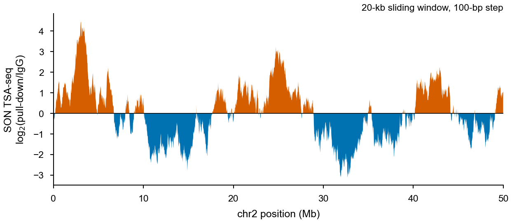
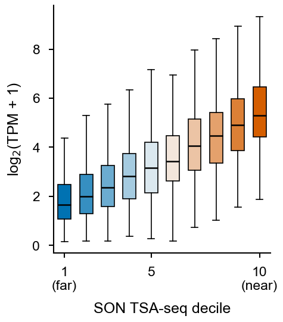

# Part 10 · SON TSA-seq: distance to nuclear speckles

[← RNA-seq](09_rnaseq.md) · [Index](../README.md) · [Next: Hi-C →](11_hic.md)

**TSA-seq** (tyramide signal amplification sequencing) labels DNA in proportion to its distance from an immunostained nuclear structure. With an antibody against **SON**, the signal works as a "cytological ruler" for proximity to nuclear speckles. Speckle-proximal regions are gene-dense and highly expressed.

The signal is broad (hundreds of kb), so it is not peak-called. It is summarised as the **pull-down / control ratio in large sliding windows**.

| Step | Tool | Output |
|---|---|---|
| Align + deduplicate | bowtie2 + Picard (part 3) | `*.map.dedup.bam` |
| Sliding-window normalisation | TSA-seq toolkit | `*.wig` → `*.bw` |
| Integrate with expression | bigWigAverageOverBed + R | TSA score per gene, deciles |

---

## 10.1 Sliding-window normalisation

```bash
module load python/2.7.9                     # toolkit is Python 2 (argparse, numpy, scipy, bx-python)
tsa=/path/to/tools/TSA-Seq-toolkit/src/tsatools_normalization.py
GSIZE=/path/to/indexes/hg19/hg19.genomesize
win=20000; tag=20k                            # 20-kb window (original paper); 50 kb also common

# sample / control pairs from the sample sheet (skip header)
paste <(awk 'NR>1{print $1}' sample_list_SON.txt) <(awk 'NR>1{print $2}' sample_list_SON.txt) |
while read s c; do
  bsub -n 4 -M 64000 -e Log/${s}_tsa.e -o Log/${s}_tsa.o \
    "python ${tsa} -N ${win} -r 100 -l 100 \
        -e BAM/${s}.map.dedup.bam -c BAM/${c}.map.dedup.bam -o TSA/${s}_TSA_${tag} \
     && wigToBigWig TSA/${s}_TSA_${tag}.wig ${GSIZE} TSA/${s}_TSA_${tag}.bw"
done
```



**[Fig. 10.1](figures/part10_tsa_signal.pdf) | SON TSA-seq signal.** SON TSA-seq enrichment (log₂ pull-down/IgG; 20-kb sliding window, 100-bp step) across 50 Mb. Positive (orange) regions are close to nuclear speckles; negative (blue) regions are distal. *Simulated data.*

| Flag | Meaning |
|---|---|
| `-N` | window size (bp) |
| `-r` | step size (bp) |
| `-l` | read length (bp) |
| `-e` / `-c` | pull-down / matched control (IgG or input) BAM |

The output is log₂(pull-down/control), normalised by the total mapped reads of each library. Positive values = speckle-proximal; negative = speckle-distal (often lamina-associated).

---

## 10.2 TSA-seq score per gene vs. expression

```bash
# TSS ± 10 kb windows from a gene BED (chr start end gene_id gene_name strand)
awk 'BEGIN{OFS="\t"} {tss = ($6=="+") ? $2 : $3; s = tss-10000; if (s<0) s=0;
     print $1, s, tss+10000, $4}' gencode.genes.bed > genes.tss10kb.bed
bigWigAverageOverBed TSA/SON_Rep1_TSA_20k.bw genes.tss10kb.bed SON_per_gene.tab
# columns: name size covered sum mean0 mean
```

```r
library(data.table); library(dplyr); library(ggplot2)

tsa  <- fread("SON_per_gene.tab", col.names = c("gene_id", "size", "covered", "sum", "mean0", "TSA"))
expr <- fread("RNA_TPM.txt")                                  # gene_id, TPM
d <- inner_join(tsa, expr, by = "gene_id") |>
  mutate(Decile = ntile(TSA, 10))

ggplot(d, aes(factor(Decile), log2(TPM + 1), fill = Decile)) +
  geom_boxplot(outlier.shape = NA, width = 0.6, linewidth = 0.25) +
  scale_fill_gradient2(low = "#0072B2", mid = "#F7F7F7", high = "#D55E00", midpoint = 5.5, guide = "none") +
  labs(x = "SON TSA-seq decile (1 = far, 10 = near)", y = expression(log[2]*"(TPM + 1)")) +
  theme_nature()
```



**[Fig. 10.2](figures/part10_tsa_expression.pdf) | Expression by speckle proximity.** Expression of genes grouped by SON TSA-seq decile at their TSS (±10 kb); speckle-proximal genes are more highly expressed. Box, IQR; line, median; whiskers, 1.5× IQR. *Simulated data.*

---

## References and resources

- Chen, Y. *et al.* Mapping 3D genome organization relative to nuclear compartments using TSA-Seq as a cytological ruler. *J. Cell Biol.* **217**, 4025–4048 (2018).
- Zhang, L. *et al.* TSA-seq reveals a largely conserved genome organization relative to nuclear speckles with small position changes tightly correlated with gene expression changes. *Genome Res.* **31**, 251–264 (2021).
- TSA-seq toolkit — <https://github.com/ma-compbio/TSA-Seq-toolkit>
- UCSC utilities (`wigToBigWig`, `bigWigAverageOverBed`) — <https://hgdownload.soe.ucsc.edu/admin/exe/>

---

[← RNA-seq](09_rnaseq.md) · [Index](../README.md) · [Next: Hi-C →](11_hic.md)
