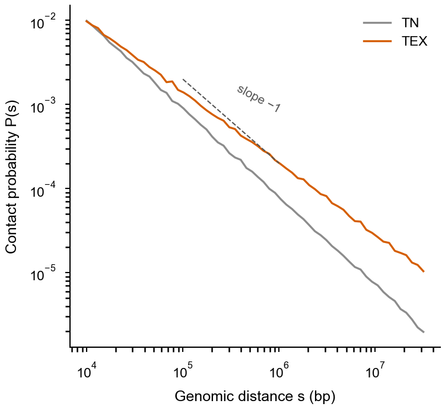
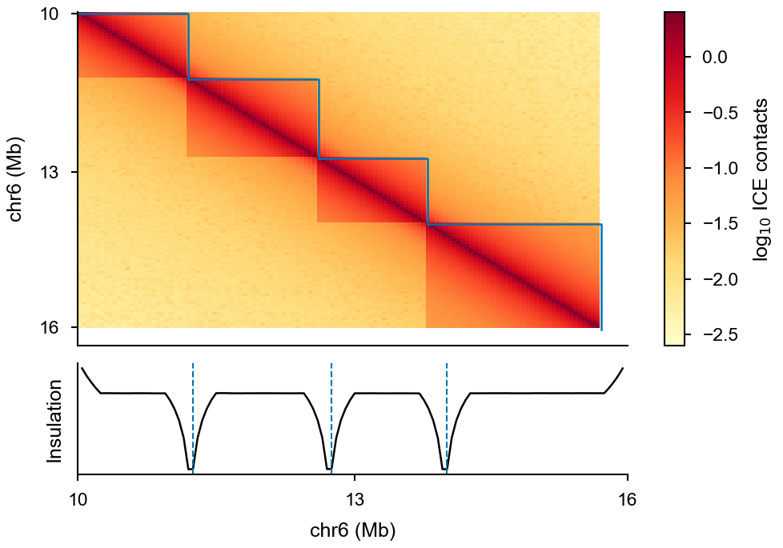

# Part 11 · Hi-C and HiChIP: contact maps, TADs and loops

[← TSA-seq](10_tsa_seq.md) · [Index](../README.md) · [Next: CRISPR screens →](12_crispr_screens.md)

```text
FASTQ ─► HiC-Pro (align, valid pairs, ICE) ─► .matrix ─► HiCExplorer (.h5)
                                                          ├─► hicPlotDistVsCounts  (QC: P(s))
                                                          ├─► hicFindTADs          (TADs, insulation)
                                                          └─► hicPlotTADs          (map + tracks)
HiChIP: HiC-Pro valid pairs ─► FitHiChIP (loops)
```

---

## 11.1 HiC-Pro: reads → contact maps

```bash
# input folder must contain one sub-folder per sample with its FASTQs
HiC-Pro -i rawdata/ -o hicpro_out/ -c config-hicpro.txt          # local run
HiC-Pro -i rawdata/ -o hicpro_out/ -c config-hicpro.txt -p       # cluster: then submit the two
                                                                  #   scripts it writes (step1, step2)
```

Edit `config-hicpro.txt` before running:

| Key | Example |
|---|---|
| `BOWTIE2_IDX_PATH`, `REFERENCE_GENOME` | `/path/to/indexes/mm10/bowtie2`, `mm10` |
| `GENOME_SIZE` | chrom sizes file |
| `GENOME_FRAGMENT` | restriction-fragment BED from `HiC-Pro/bin/utils/digest_genome.py -r ^GATC -o mm10_MboI.bed mm10.fa` |
| `LIGATION_SITE` | `GATCGATC` (MboI / DpnII) |
| `BIN_SIZE` | `20000 40000 150000 500000` |

Chromosome names must match the bowtie2 index. Steps (`-s`): `mapping`, `proc_hic`, `quality_checks`, `build_contact_maps`, `ice_norm`.

**QC to check** (`hic_results/stats/`): valid-pair fraction > 50 %, *cis*/*trans* ratio > 1.5, long-range *cis* (> 20 kb) > 40 % of valid pairs, low duplication.

---

## 11.2 HiCExplorer: distance decay, TADs and plots

```bash
conda activate hicexplorer
s=TEX
for bin in 40000 150000 500000; do
  hicConvertFormat --inputFormat hicpro --outputFormat h5 \
    --matrices      hicpro_out/hic_results/matrix/${s}/iced/${bin}/${s}_${bin}_iced.matrix \
    --bedFileHicpro hicpro_out/hic_results/matrix/${s}/raw/${bin}/${s}_${bin}_abs.bed \
    -o ${s}_${bin}.h5
done

# QC: contact probability vs distance for several samples
hicPlotDistVsCounts -m TN_40000.h5 TEX_40000.h5 --labels TN TEX -o PofS.pdf
```



**[Fig. 11.1](figures/part11_distance_decay.pdf) | Distance decay, P(s).** Contact probability as a function of genomic distance for two conditions; dashed line, slope −1. *Simulated data.*

```bash
# TADs (also writes an insulation-score track: *_tad_score.bm)
hicFindTADs -m ${s}_40000.h5 --outPrefix ${s}_40k_TADs \
  --correctForMultipleTesting fdr --thresholdComparisons 0.05 -p 8

# quick heatmap
hicPlotMatrix -m ${s}_40000.h5 --region chr6:10000000-16000000 --log1p -o ${s}_chr6.pdf
```

### Map + TADs + other tracks (`hicPlotTADs`, pyGenomeTracks format)

`tracks.ini`:

```ini
[hic matrix]
file = TEX_40000.h5
title = TEX Hi-C (40 kb)
depth = 3000000
transform = log1p
file_type = hic_matrix

[tads]
file = TEX_40k_TADs_domains.bed
display = triangles
border_color = black
color = none
overlay_previous = share-y

[spacer]

[insulation]
file = TEX_40k_TADs_tad_score.bm
title = insulation
height = 2
file_type = bedgraph_matrix

[h3k27ac]
file = Wig/pool_TEX_H3K27ac.bw
title = H3K27ac
height = 2
color = #D55E00

[genes]
file = genes.bed
height = 3

[x-axis]
```

```bash
hicPlotTADs --tracks tracks.ini --region chr6:10000000-16000000 -o TEX_TADs_chr6.pdf
```



**[Fig. 11.2](figures/part11_contact_map.pdf) | Contact map, TADs and insulation.** ICE-normalized contact map (40-kb bins) with TADs called by `hicFindTADs` outlined (top), and the insulation score along the same region (bottom); dashed lines mark TAD boundaries at insulation minima. *Simulated data.*

---

## 11.3 Alternatives

```bash
# HOMER (from a Hi-C tag directory)
findTADsAndLoops.pl find HicTagDir/ -cpu 10 -res 3000 -window 15000 -genome mm10 -p badRegions.bed

# FitHiChIP: significant loops from HiChIP (HiC-Pro valid pairs + ChIP peaks in the config)
bash FitHiChIP_HiCPro.sh -C configfile_FitHiChIP
```

FitHiChIP writes loops as BEDPE; view them as arcs in IGV/WashU or with a `[links]` section in `tracks.ini` (`file_type = links`).

---

## References and resources

- Servant, N. *et al.* HiC-Pro: an optimized and flexible pipeline for Hi-C data processing. *Genome Biol.* **16**, 259 (2015). — <https://github.com/nservant/HiC-Pro>
- Ramírez, F. *et al.* High-resolution TADs reveal DNA sequences underlying genome organization in flies. *Nat. Commun.* **9**, 189 (2018). — HiCExplorer: <https://hicexplorer.readthedocs.io>
- Imakaev, M. *et al.* Iterative correction of Hi-C data reveals hallmarks of chromosome organization. *Nat. Methods* **9**, 999–1003 (2012). (ICE normalisation)
- Bhattacharyya, S. *et al.* Identification of significant chromatin contacts from HiChIP data by FitHiChIP. *Nat. Commun.* **10**, 4221 (2019). — <https://ay-lab.github.io/FitHiChIP/>
- Durand, N. C. *et al.* Juicer provides a one-click system for analyzing loop-resolution Hi-C experiments. *Cell Syst.* **3**, 95–98 (2016). — <https://github.com/aidenlab/juicer>
- Abdennur, N. & Mirny, L. A. Cooler: scalable storage for Hi-C data and other genomically labeled arrays. *Bioinformatics* **36**, 311–316 (2020). — <https://cooler.readthedocs.io>
- pyGenomeTracks (track file format) — <https://pygenometracks.readthedocs.io>
- HOMER Hi-C analysis — <http://homer.ucsd.edu/homer/interactions2/>

---

[← TSA-seq](10_tsa_seq.md) · [Index](../README.md) · [Next: CRISPR screens →](12_crispr_screens.md)
