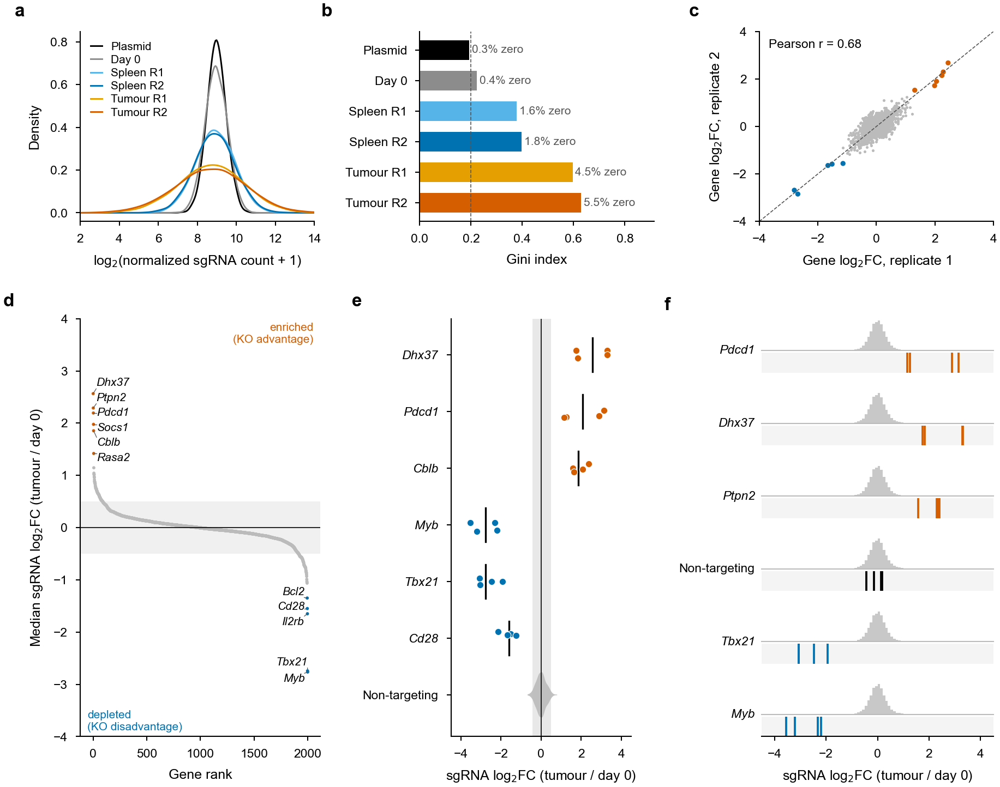

# 12 · Pooled CRISPR screens

[← Hi-C](11_hic.md) · [Index](../README.md) · [Next: scRNA-seq →](13_scrnaseq.md)

A pooled knockout screen compares sgRNA abundance between a reference (plasmid or day-0 cells) and the selected population (e.g. tumour-infiltrating T cells). Genes whose guides are **enriched** confer an advantage when knocked out; genes whose guides are **depleted** are required. The workflow:

1. **Count** guides per sample (from FASTQ, or merge per-sample count tables) and check library QC (mapping rate, zero-count guides, Gini index).
2. **Test** each gene (MAGeCK RRA or MLE; RIGER as an alternative).
3. **Plot**: guide-count distributions, QC, replicate concordance, gene rank plot, sgRNA-level plot of top hits, sgRNA distributions of example genes.

## 12.1 MAGeCK: count and test

```bash
conda create -n mageck -c bioconda -c conda-forge mageck
conda activate mageck

# library.csv: sgRNA_id,sequence,gene   ;   ntc.txt: one non-targeting sgRNA id per line
mageck count -l library.csv -n Screen \
  --sample-label Plasmid,Day0,Spleen_R1,Spleen_R2,Tumour_R1,Tumour_R2 \
  --fastq Plasmid.fq.gz Day0.fq.gz Spleen_R1.fq.gz Spleen_R2.fq.gz Tumour_R1.fq.gz Tumour_R2.fq.gz \
  --norm-method control --control-sgrna ntc.txt
# → Screen.count.txt, Screen.count_normalized.txt, Screen.countsummary.txt

# robust rank aggregation (RRA): tumour vs day 0, replicates pooled
mageck test -k Screen.count.txt -t Tumour_R1,Tumour_R2 -c Day0 -n Tumour_vs_Day0 \
  --norm-method control --control-sgrna ntc.txt
# → Tumour_vs_Day0.gene_summary.txt, Tumour_vs_Day0.sgrna_summary.txt
```

Library QC targets (`Screen.countsummary.txt`):

| Metric | Plasmid / day 0 | In vivo samples |
|---|---|---|
| Reads mapped to library | > 65 % | > 65 % |
| Zero-count sgRNAs | < 1 % | a few % expected after bottlenecks |
| Gini index | < 0.1–0.2 | rises with selection; very high (> 0.5) means too few cells per guide |
| Coverage | ≥ 300–500 reads per guide | as high as cell numbers allow |

## 12.2 Starting from per-sample guide-count tables

Some sequencing cores return one count table per sample (`sgRNA  barcode  count`) instead of FASTQ files. The script below:

1. merges the tables;
2. assigns genes from the library;
3. removes guides that are poorly represented at day 0;
4. writes a raw-count table for `mageck test`;
5. makes quick sgRNA- and gene-level rank plots for each cell line.

```r
## screen_counts.R — merge guide counts, filter, write MAGeCK input, quick log2FC rank plots
library(data.table); library(dplyr); library(tidyr); library(ggplot2); library(ggrepel)
# theme_nature() and save_fig() are defined in chapter 5

## samples.txt: file  sample  line  time    (time = d0 or end; one of each per cell line)
## library.csv: sgRNA,gene                  (non-targeting guides: gene = NTC)
ss  <- fread("samples.txt")
lib <- fread("library.csv")

read_counts <- function(f, s)
  fread(f, col.names = c("sgRNA", "barcode", s))[, sgRNA := gsub(" ", "_", sgRNA)]

cnt <- Map(read_counts, ss$file, ss$sample) |>
  Reduce(f = \(a, b) full_join(a, b, by = c("sgRNA", "barcode"))) |>
  as.data.frame() |>
  mutate(across(all_of(ss$sample), \(x) coalesce(x, 0L))) |>   # guide absent from a file = 0 reads
  left_join(lib, by = "sgRNA")
## no library file? take the gene from the guide name, e.g. Pdcd1_2 → Pdcd1:
# mutate(gene = if_else(grepl("_", sgRNA), sub("_.*", "", sgRNA), "NTC"))
stopifnot(!anyNA(cnt$gene))                                    # every guide must be in the library

## drop guides with < 20 reads in any day-0 sample (lost before selection, LFC is noise)
d0   <- ss$sample[ss$time == "d0"]
keep <- rowSums(cnt[, d0, drop = FALSE] >= 20) == length(d0)
message(sum(!keep), " of ", nrow(cnt), " guides removed")
cnt_f <- cnt[keep, ]

## MAGeCK input: raw counts (MAGeCK normalises itself), NTC list, one comparison per line
fwrite(select(cnt_f, sgRNA, gene, all_of(ss$sample)), "Screen.count_filtered.txt", sep = "\t")
fwrite(distinct(filter(cnt_f, gene == "NTC"), sgRNA), "ntc.txt", col.names = FALSE)
ss |> select(line, time, sample) |> pivot_wider(names_from = time, values_from = sample) |>
  select(line, d0, end) |> fwrite("comparisons.txt", sep = "\t", col.names = FALSE)

## log2FC per guide: scale every sample to the median library size, pseudocount 1
size <- median(colSums(cnt_f[, ss$sample]))
lfc <- cnt_f |>
  mutate(across(all_of(ss$sample), \(x) x / sum(x) * size)) |>
  pivot_longer(all_of(ss$sample), names_to = "sample", values_to = "norm") |>
  left_join(ss, by = "sample") |>
  select(sgRNA, gene, line, time, norm) |>
  pivot_wider(names_from = time, values_from = norm) |>
  mutate(log2FC = log2((end + 1) / (d0 + 1)))

## gene level: median over guides; all NTCs are pooled as one reference "gene"
gene_lfc <- lfc |> group_by(line, gene) |>
  summarise(log2FC = median(log2FC), n_sgRNA = n(), .groups = "drop")

fwrite(lfc, "log2FC_sgRNA.txt", sep = "\t")
gene_lfc |> pivot_wider(id_cols = gene, names_from = line, values_from = log2FC,
                        names_prefix = "log2FC_") |>
  fwrite("log2FC_gene_all_lines.txt", sep = "\t")

## rank plots, one tall panel per cell line; NTCs in black, top/bottom n labelled
rank_plot <- function(d, lab_col, n_lab = 10) {
  d <- d |> group_by(line) |> arrange(desc(log2FC), .by_group = TRUE) |>
    mutate(rank = row_number(), lab = rank <= n_lab | rank > n() - n_lab) |> ungroup()
  ggplot(d, aes(rank, log2FC)) +
    geom_hline(yintercept = 0, linewidth = 0.25, colour = "grey60") +
    geom_point(data = filter(d, gene != "NTC"), size = 0.4, colour = "grey70") +
    geom_point(data = filter(d, gene == "NTC"), size = 0.6, colour = "black") +
    geom_text_repel(data = filter(d, lab), aes(label = .data[[lab_col]]), size = 1.6,
                    fontface = if (lab_col == "gene") "italic" else "plain",
                    segment.size = 0.2, min.segment.length = 0, max.overlaps = Inf) +
    facet_wrap(~ line, nrow = 1, scales = "free_x") +
    labs(x = "Rank", y = expression(log[2]*"FC (end / day 0)")) +
    theme_nature()
}
save_fig(rank_plot(lfc, "sgRNA"), "p_rank_log2FC_sgRNA.pdf", w = 183, h = 110)
save_fig(rank_plot(gene_lfc, "gene"), "p_rank_log2FC_gene.pdf", w = 183, h = 110)
```

Then test each cell line with MAGeCK:

```bash
# comparisons.txt: line  d0_sample  end_sample
while IFS=$'\t' read -r cl d0 end; do
  mageck test -k Screen.count_filtered.txt -t "$end" -c "$d0" -n "${cl}_end_vs_d0" \
    --norm-method control --control-sgrna ntc.txt
done < comparisons.txt
```

> Give MAGeCK **raw** counts. If you pass a table that is already normalised and rounded, MAGeCK normalises it a second time and the variance model is fitted to rescaled counts. With a single replicate per cell line, MAGeCK estimates variance from all guides pooled, so treat the FDR as a ranking aid and confirm hits by guide concordance (section 12.3e, f).

## 12.3 Plots in R

```r
library(data.table); library(dplyr); library(tidyr); library(ggplot2); library(ggrepel)
# theme_nature() is defined in chapter 5

## a. guide-count distribution per sample
cnt <- fread("Screen.count_normalized.txt") |>
  pivot_longer(-c(sgRNA, Gene), names_to = "Sample", values_to = "Count")
ggplot(cnt, aes(log2(Count + 1), colour = Sample)) +
  geom_density(linewidth = 0.4) +
  labs(x = expression(log[2]*"(normalized sgRNA count + 1)"), y = "Density", colour = NULL) +
  theme_nature()

## b. library QC: Gini index and zero-count guides
qc <- fread("Screen.countsummary.txt")
ggplot(qc, aes(GiniIndex, reorder(Label, GiniIndex))) +
  geom_col(fill = "grey60", width = 0.65) +
  geom_text(aes(label = sprintf("%.1f%% zero", 100 * Zerocounts / TotalsgRNAs)),
            hjust = -0.1, size = 1.8) +
  geom_vline(xintercept = 0.2, linetype = 2, linewidth = 0.2) +
  labs(x = "Gini index", y = NULL) + theme_nature()

## c. replicate concordance (gene-level median log2FC per replicate)
raw <- fread("Screen.count_normalized.txt")
lfc <- raw |>
  mutate(R1 = log2((Tumour_R1 + 0.5) / (Day0 + 0.5)),
         R2 = log2((Tumour_R2 + 0.5) / (Day0 + 0.5))) |>
  group_by(Gene) |> summarise(R1 = median(R1), R2 = median(R2))
r <- cor(lfc$R1, lfc$R2)
ggplot(lfc, aes(R1, R2)) + geom_point(size = 0.3, colour = "grey60") +
  geom_abline(linetype = 2, linewidth = 0.2) +
  annotate("text", x = -Inf, y = Inf, hjust = -0.1, vjust = 1.5, size = 2,
           label = sprintf("Pearson r = %.2f", r)) +
  labs(x = expression("Gene"~log[2]*"FC, replicate 1"), y = expression("Gene"~log[2]*"FC, replicate 2")) +
  theme_nature()

## d. gene rank plot (MAGeCK RRA): enriched genes on the left, depleted on the right; tall panel
gs <- fread("Tumour_vs_Day0.gene_summary.txt") |>
  transmute(Gene = id, LFC = `pos|lfc`, FDR = pmin(`pos|fdr`, `neg|fdr`)) |>
  filter(Gene != "NonTargeting") |>
  arrange(desc(LFC)) |> mutate(Rank = row_number(),
                         Hit = case_when(FDR < 0.05 & LFC > 0 ~ "Enriched",
                                         FDR < 0.05 & LFC < 0 ~ "Depleted", TRUE ~ "NS"))
lab <- bind_rows(slice_min(gs, LFC, n = 5), slice_max(gs, LFC, n = 6)) |> filter(Hit != "NS")
ggplot(gs, aes(Rank, LFC, colour = Hit)) +
  annotate("rect", xmin = -Inf, xmax = Inf, ymin = -0.5, ymax = 0.5, fill = "grey95") +
  geom_hline(yintercept = 0, linewidth = 0.25) +
  geom_point(size = 0.4) +
  geom_text_repel(data = lab, aes(label = Gene), size = 2, fontface = "italic", colour = "black",
                  segment.size = 0.2, min.segment.length = 0, box.padding = 0.3,
                  nudge_x = ifelse(lab$LFC > 0, 150, -150), direction = "y", max.overlaps = Inf) +
  scale_colour_manual(values = c(Enriched = "#D55E00", Depleted = "#0072B2", NS = "grey75")) +
  labs(x = "Gene rank", y = expression("Median sgRNA"~log[2]*"FC")) +
  theme_nature() + theme(legend.position = "none")
ggsave("rank_plot.pdf", width = 45, height = 90, units = "mm")   # tall and narrow

## e. sgRNA-level plot for top hits vs non-targeting controls
sg  <- fread("Tumour_vs_Day0.sgrna_summary.txt")
ntc <- sg |> filter(Gene == "NonTargeting")
show <- c("Dhx37", "Pdcd1", "Cblb", "Myb", "Tbx21", "Cd28")
d <- sg |> filter(Gene %in% show) |> mutate(Gene = factor(Gene, levels = rev(show)))
ggplot(d, aes(LFC, Gene)) +
  annotate("rect", xmin = quantile(ntc$LFC, 0.025), xmax = quantile(ntc$LFC, 0.975),
           ymin = -Inf, ymax = Inf, fill = "grey92") +
  geom_vline(xintercept = 0, linewidth = 0.25) +
  geom_jitter(aes(colour = LFC > 0), height = 0.12, size = 1) +
  stat_summary(fun = median, geom = "crossbar", width = 0.5, linewidth = 0.2) +
  scale_colour_manual(values = c(`TRUE` = "#D55E00", `FALSE` = "#0072B2"), guide = "none") +
  labs(x = expression("sgRNA"~log[2]*"FC"), y = NULL) +
  theme_nature() + theme(axis.text.y = element_text(face = "italic"))

## f. sgRNAs of example genes against the distribution of all sgRNAs
##    per gene: library histogram on top, that gene's guides in a separate strip below
genes <- c("Pdcd1", "Dhx37", "Ptpn2", "NonTargeting", "Tbx21", "Myb")
bg  <- sg |> select(LFC)                                      # all sgRNAs, drawn in every row
ex  <- sg |> filter(Gene %in% genes) |>
  group_by(Gene) |> slice_head(n = 4) |> ungroup() |>        # NonTargeting: show 4 example guides
  mutate(Gene = factor(Gene, levels = genes),
         Dir  = case_when(Gene == "NonTargeting" ~ "NTC", LFC > 0 ~ "Up", TRUE ~ "Down"))
ggplot() +
  geom_histogram(data = bg, aes(LFC, after_stat(ncount)), binwidth = 0.1, fill = "grey78") +  # y 0–1
  annotate("rect", xmin = -Inf, xmax = Inf, ymin = -0.7, ymax = -0.1, fill = "grey96") +
  geom_segment(data = ex, aes(x = LFC, xend = LFC, y = -0.7, yend = -0.1, colour = Dir),
               linewidth = 0.4) +
  facet_grid(Gene ~ ., switch = "y") +
  scale_colour_manual(values = c(Up = "#D55E00", Down = "#0072B2", NTC = "black"), guide = "none") +
  labs(x = expression("sgRNA"~log[2]*"FC"), y = NULL) +
  theme_nature() +
  theme(axis.text.y = element_blank(), axis.ticks.y = element_blank(), axis.line.y = element_blank(),
        strip.placement = "outside", strip.text.y.left = element_text(angle = 0, face = "italic"),
        panel.spacing = unit(0.5, "mm"))
```

> A real hit has **several concordant guides** clearly outside the non-targeting range (grey band). A single extreme guide is usually an off-target or bottleneck artefact. With strong bottlenecks (in vivo screens), use more replicates or animals and consider `mageck mle` with a replicate-aware design matrix.

## 12.4 RIGER (gene ranking from guide-level scores)

Input (tab-separated, this exact header order):

```text
Construct   GeneSymbol   NormalizedScore   Construct Rank   HairpinWeight
sgTox_1     Tox          3.21              1                1
```

```bash
rigerj=/path/to/tools/rigerj/target/rigerj-2.0.2-assembly.jar
java -jar ${rigerj} -inputFile Input_ForRIGER_d15_spleen.txt \
     -scoringMethod SecondBestRank -outputFile RIGER_d15_spleen_SBR
# -scoringMethod: KSbyScore | WtSum | SecondBestRank
```

Output columns: `Gene Rank`, `Gene Name`, `Score`, `p-value`, `p-value rank`, `Hairpin ranks`. For negative selection, rank guides in the opposite direction.

## 12.5 CRISPRO (map scores to protein domains/structure)

```bash
source activate crispro
crispro --scores Donovan2017_inputCRISPRO.csv \
        -i Donovan2017_IDs.txt \
        -a annotations/CRISPRO.GRCh37.ensembl90.20180901.csv.gz \
        -o out_CRISPRO
conda deactivate
```

---

## Example output



**Fig. 11 | Pooled in vivo CRISPR knockout screen.** **a**, Distribution of normalized sgRNA counts per sample; selection in vivo widens the distribution compared with the plasmid and day-0 library. **b**, Library evenness (Gini index; dashed line, 0.2) and percentage of zero-count sgRNAs per sample. **c**, Concordance of gene-level log₂ fold changes (tumour versus day 0) between biological replicates; coloured points are significant hits. **d**, Genes ranked by median sgRNA log₂ fold change, from most enriched (left) to most depleted (right); significantly enriched (orange) and depleted (blue) genes (MAGeCK RRA, FDR < 0.05) are labelled; grey band, |log₂FC| < 0.5. **e**, Individual sgRNA log₂ fold changes for top hits (dots; bar, median) against the distribution of non-targeting controls (violin; grey band, central 95%). **f**, For each example gene, the distribution of log₂ fold changes of all sgRNAs in the library (grey histogram, top) and the log₂ fold changes of the individual sgRNAs targeting that gene (coloured lines, strip below); four non-targeting sgRNAs (black) are shown for comparison. Layout after Chen et al., *Cell* 2021, Fig. 1d. *Simulated data for illustration.*

---

## References and resources

- Li, W. *et al.* MAGeCK enables robust identification of essential genes from genome-scale CRISPR/Cas9 knockout screens. *Genome Biol.* **15**, 554 (2014). — <https://sourceforge.net/p/mageck/wiki/Home/>
- Li, W. *et al.* Quality control, modeling, and visualization of CRISPR screens with MAGeCK-VISPR. *Genome Biol.* **16**, 281 (2015).
- Wang, B. *et al.* Integrative analysis of pooled CRISPR genetic screens using MAGeCKFlute. *Nat. Protoc.* **14**, 756–780 (2019). — <https://bioconductor.org/packages/MAGeCKFlute>
- Luo, B. *et al.* Highly parallel identification of essential genes in cancer cells. *Proc. Natl Acad. Sci. USA* **105**, 20380–20385 (2008). (RIGER)
- He, W. *et al.* De novo identification of essential protein domains from CRISPR-Cas9 tiling-sgRNA knockout screens. *Nat. Commun.* **10**, 4541 (2019). (CRISPRO) — <https://gitlab.com/bauerlab/crispro>
- Hart, T. & Moffat, J. BAGEL: a computational framework for identifying essential genes from pooled library screens. *BMC Bioinformatics* **17**, 164 (2016).
- Dong, M. B. *et al.* Systematic immunotherapy target discovery using genome-scale in vivo CRISPR screens in CD8 T cells. *Cell* **178**, 1189–1204 (2019). (example of an in vivo T-cell screen)
- Chen, Z. *et al.* In vivo CD8⁺ T cell CRISPR screening reveals control by Fli1 in infection and cancer. *Cell* **184**, 1262–1280 (2021). <https://doi.org/10.1016/j.cell.2021.02.019> (Fig. 1d: sgRNA distribution plot used for panel f)

---

[← Hi-C](11_hic.md) · [Index](../README.md) · [Next: scRNA-seq →](13_scrnaseq.md)
