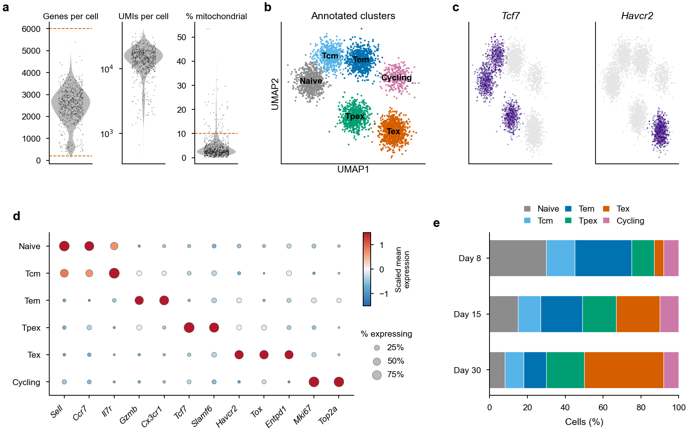

# 13 · Single-cell RNA-seq (Seurat / Scanpy)

[← CRISPR screens](12_crispr_screens.md) · [Index](../README.md) · [Next: scATAC-seq →](14_scatacseq.md)

```text
Cell Ranger count ─► filtered_feature_bc_matrix.h5
   └─► QC (genes, UMIs, % mito) ─► doublet removal ─► normalise ─► HVGs ─► PCA
          └─► Harmony (if several samples) ─► neighbours ─► clusters ─► UMAP
                 └─► markers ─► annotation ─► composition ─► pseudobulk DE ─► regulons (SCENIC)
```

The examples use Seurat (R). Each step has a Scanpy equivalent (see the [spatial chapter](15_spatial.md) and the *single-cell best practices* book in the references).

---

## 13.1 Cell Ranger

```bash
cellranger count --id=TEX_d30 --transcriptome=/path/to/refdata-gex-mm10-2020-A \
  --fastqs=/path/to/Fastq --sample=TEX_d30 --localcores=16 --localmem=64
# → TEX_d30/outs/filtered_feature_bc_matrix.h5, web_summary.html
```

Check `web_summary.html`: estimated cells, median genes per cell, sequencing saturation, and the barcode-rank "knee".

---

## 13.2 Load, QC and filter

```r
library(Seurat); library(dplyr); library(ggplot2); library(patchwork)

samples <- c("TEX_d8", "TEX_d15", "TEX_d30")
objs <- lapply(samples, function(s) {
  m <- Read10X_h5(sprintf("%s/outs/filtered_feature_bc_matrix.h5", s))
  o <- CreateSeuratObject(m, project = s, min.cells = 3, min.features = 200)
  o$sample <- s
  o
})
seu <- merge(objs[[1]], objs[-1], add.cell.ids = samples)

seu[["percent.mt"]] <- PercentageFeatureSet(seu, pattern = "^mt-")   # "^MT-" for human
VlnPlot(seu, c("nFeature_RNA", "nCount_RNA", "percent.mt"), group.by = "sample", pt.size = 0, ncol = 3)

seu <- subset(seu, nFeature_RNA > 200 & nFeature_RNA < 6000 & percent.mt < 10)
```

Thresholds depend on tissue and chemistry: look at the distributions (Fig. 13a) and cut obvious outliers rather than copying numbers.

**Doublets** (per sample, before merging is best):

```r
library(scDblFinder); library(SingleCellExperiment)
sce <- scDblFinder(as.SingleCellExperiment(JoinLayers(seu)), samples = "sample")
seu$doublet <- sce$scDblFinder.class
seu <- subset(seu, doublet == "singlet")
```

---

## 13.3 Normalise, integrate, cluster

```r
seu <- NormalizeData(seu) |> FindVariableFeatures(nfeatures = 2000) |> ScaleData() |>
       RunPCA(npcs = 50)
ElbowPlot(seu, ndims = 50)                                    # choose ~20–30 PCs

## Harmony across samples (Seurat v5 layer integration)
seu <- IntegrateLayers(seu, method = HarmonyIntegration,
                       orig.reduction = "pca", new.reduction = "harmony")
seu <- FindNeighbors(seu, reduction = "harmony", dims = 1:30) |>
       FindClusters(resolution = 0.6) |>
       RunUMAP(reduction = "harmony", dims = 1:30)
seu <- JoinLayers(seu)

DimPlot(seu, group.by = c("sample", "seurat_clusters"), label = TRUE)
```

> Exclude TCR/BCR (`^Tr[abgd][vj]`), ribosomal and cell-cycle genes from the variable features if they drive clusters you are not interested in. Regress cell cycle (`CellCycleScoring` + `ScaleData(vars.to.regress = c("S.Score","G2M.Score"))`) only if it masks biology.

---

## 13.4 Markers and annotation

```r
markers <- FindAllMarkers(seu, only.pos = TRUE, min.pct = 0.25, logfc.threshold = 0.25)
top5 <- markers |> group_by(cluster) |> slice_max(avg_log2FC, n = 5)
write.csv(markers, "markers_all_clusters.csv", row.names = FALSE)

## reference-based annotation (mouse immune: ImmGen)
library(SingleR); library(celldex)
ref  <- ImmGenData()
pred <- SingleR(GetAssayData(seu, layer = "data"), ref = ref, labels = ref$label.fine,
                clusters = seu$seurat_clusters)
seu$singleR <- pred$labels[match(seu$seurat_clusters, rownames(pred))]

## final labels from markers + reference
seu$celltype <- recode(seu$seurat_clusters,
  `0` = "Tex", `1` = "Tem", `2` = "Naive", `3` = "Tpex", `4` = "Tcm", `5` = "Cycling")
Idents(seu) <- "celltype"
```

### Visualisation

```r
ct_cols <- c(Naive = "#8C8C8C", Tcm = "#56B4E9", Tem = "#0072B2",
             Tpex = "#009E73", Tex = "#D55E00", Cycling = "#CC79A7")

p_umap <- DimPlot(seu, cols = ct_cols, label = TRUE, label.size = 2.2, pt.size = 0.1) +
          NoLegend() + theme_nature()
p_feat <- FeaturePlot(seu, c("Tcf7", "Havcr2"), order = TRUE, pt.size = 0.1,
                      cols = c("grey90", "#3F007D"), ncol = 2) & theme_nature()
p_dot  <- DotPlot(seu, features = c("Sell", "Ccr7", "Il7r", "Gzmb", "Cx3cr1", "Tcf7", "Slamf6",
                                    "Havcr2", "Tox", "Entpd1", "Mki67", "Top2a"),
                  cols = "RdBu", dot.scale = 3) + RotatedAxis() + theme_nature()

## composition per sample
comp <- seu@meta.data |> count(sample, celltype) |> group_by(sample) |> mutate(pct = 100 * n / sum(n))
p_comp <- ggplot(comp, aes(pct, sample, fill = celltype)) + geom_col(width = 0.65) +
  scale_fill_manual(values = ct_cols) + labs(x = "Cells (%)", y = NULL, fill = NULL) + theme_nature()

ggsave("fig_scRNA.pdf", (p_umap | p_feat) / (p_dot | p_comp), width = 183, height = 150, units = "mm")
```

> Composition changes need a statistical test across **biological replicates** (e.g. `propeller` in the *speckle* package, or scCODA), not a χ² test on cell counts.

---

## 13.5 Differential expression between conditions (pseudobulk)

Testing cells as replicates inflates significance. Sum counts per sample × cell type and use DESeq2:

```r
pb <- AggregateExpression(seu, assays = "RNA", group.by = c("sample", "celltype"),
                          return.seurat = TRUE)
pb_tex <- subset(pb, celltype == "Tex")
library(DESeq2)
cd  <- data.frame(row.names = colnames(pb_tex), condition = pb_tex$condition)   # add from metadata
dds <- DESeqDataSetFromMatrix(GetAssayData(pb_tex, layer = "counts"), cd, ~ condition) |> DESeq()
res <- results(dds, contrast = c("condition", "KO", "WT"))
```

Volcano and heatmap code from chapters 5 and 9 apply unchanged.

---

## 13.6 Gene-regulatory networks (SCENIC)

```r
library(SCENIC)
exprMat  <- as.matrix(GetAssayData(seu, layer = "counts"))
cellInfo <- data.frame(celltype = seu$celltype)
# cisTarget databases (mouse mm10):
#   https://resources.aertslab.org/cistarget/databases/mus_musculus/mm10/
scenicOptions <- initializeScenic(org = "mgi", dbDir = "cisTarget_databases", nCores = 8)
```

For more than a few thousand cells, use **pySCENIC** (`pyscenic grn` → `ctx` → `aucell`); it is much faster than R GENIE3. Regulon AUC scores can be added to the Seurat object and plotted with `FeaturePlot` / `DotPlot` like genes.

---

## Example output



**Fig. 13 | scRNA-seq of antigen-specific CD8⁺ T cells.** **a**, Per-cell QC: genes detected, UMIs and percentage of mitochondrial reads. Dashed lines, filtering thresholds (200–6,000 genes; < 10% mitochondrial). **b**, UMAP of Harmony-integrated cells coloured by annotated cluster. **c**, Expression of *Tcf7* (progenitor/memory) and *Havcr2* (terminal exhaustion). **d**, Marker dot plot: dot size, fraction of cells expressing; colour, scaled mean expression. **e**, Cell-type composition per time point. *Simulated data for illustration.*

---

## References and resources

- Hao, Y. *et al.* Dictionary learning for integrative, multimodal and scalable single-cell analysis. *Nat. Biotechnol.* **42**, 293–304 (2024). (Seurat v5) — <https://satijalab.org/seurat/>
- Wolf, F. A., Angerer, P. & Theis, F. J. SCANPY: large-scale single-cell gene expression data analysis. *Genome Biol.* **19**, 15 (2018). — <https://scanpy.readthedocs.io>
- Korsunsky, I. *et al.* Fast, sensitive and accurate integration of single-cell data with Harmony. *Nat. Methods* **16**, 1289–1296 (2019).
- Germain, P.-L. *et al.* Doublet identification in single-cell sequencing data using scDblFinder. *F1000Research* **10**, 979 (2021).
- Aran, D. *et al.* Reference-based analysis of lung single-cell sequencing reveals a transitional profibrotic macrophage. *Nat. Immunol.* **20**, 163–172 (2019). (SingleR)
- Squair, J. W. *et al.* Confronting false discoveries in single-cell differential expression. *Nat. Commun.* **12**, 5692 (2021). (why pseudobulk)
- Aibar, S. *et al.* SCENIC: single-cell regulatory network inference and clustering. *Nat. Methods* **14**, 1083–1086 (2017); Van de Sande, B. *et al.* A scalable SCENIC workflow for single-cell gene regulatory network analysis. *Nat. Protoc.* **15**, 2247–2276 (2020).
- Heumos, L. *et al.* Best practices for single-cell analysis across modalities. *Nat. Rev. Genet.* **24**, 550–572 (2023). — online book: <https://www.sc-best-practices.org>
- 10x Genomics Cell Ranger documentation — <https://www.10xgenomics.com/support/software/cell-ranger>

---

[← CRISPR screens](12_crispr_screens.md) · [Index](../README.md) · [Next: scATAC-seq →](14_scatacseq.md)
