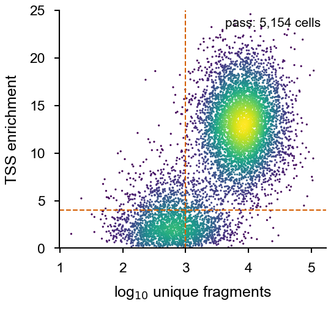
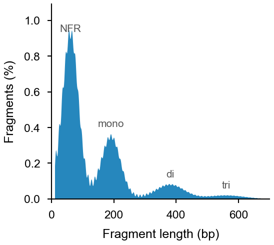
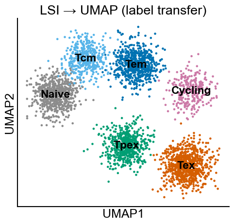
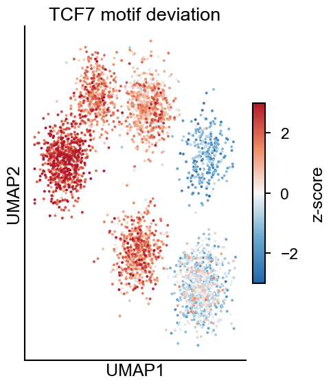
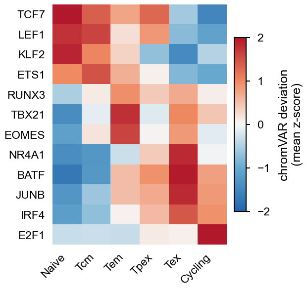
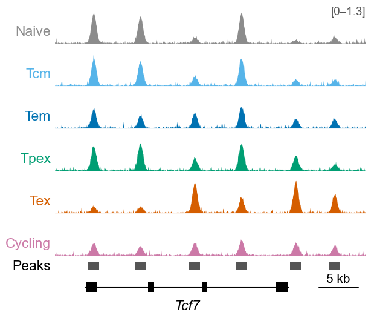

# Part 14 · Single-cell ATAC-seq (Signac / ArchR): QC, clustering, chromVAR and tracks

[← scRNA-seq](13_scrnaseq.md) · [Index](../README.md) · [Next: Spatial →](15_spatial.md)

```text
Cell Ranger ATAC ─► fragments.tsv.gz + peak matrix
  └─► QC (TSS enrichment, fragments, nucleosome signal, FRiP, blacklist)
        └─► TF-IDF ─► LSI (SVD) ─► UMAP / clusters
              ├─► gene activity ─► label transfer from scRNA-seq
              ├─► cluster-specific peaks (MACS2) ─► differential accessibility
              ├─► motifs ─► chromVAR deviations ─► footprints
              └─► coverage tracks · peak–gene links · pseudobulk bigWigs
```

Examples use **Signac** (Seurat ecosystem). §14.8 lists the equivalent **ArchR** functions.

---

## 14.1 Cell Ranger ATAC

```bash
cellranger-atac count --id=TEX_atac --reference=/path/to/refdata-cellranger-arc-mm10-2020-A-2.0.0 \
  --fastqs=/path/to/Fastq --sample=TEX_atac --localcores=16 --localmem=64
# → outs/fragments.tsv.gz(.tbi), filtered_peak_bc_matrix.h5, singlecell.csv, web_summary.html
```

---

## 14.2 Create the object and QC

```r
library(Signac); library(Seurat); library(EnsDb.Mmusculus.v79); library(BSgenome.Mmusculus.UCSC.mm10)
library(ggplot2); library(dplyr)

counts <- Read10X_h5("TEX_atac/outs/filtered_peak_bc_matrix.h5")
meta   <- read.csv("TEX_atac/outs/singlecell.csv", header = TRUE, row.names = 1)

annot <- GetGRangesFromEnsDb(EnsDb.Mmusculus.v79)
seqlevelsStyle(annot) <- "UCSC"; genome(annot) <- "mm10"

chrom <- CreateChromatinAssay(counts, sep = c(":", "-"), genome = "mm10",
                              fragments = "TEX_atac/outs/fragments.tsv.gz",
                              min.cells = 10, min.features = 200, annotation = annot)
atac <- CreateSeuratObject(chrom, assay = "peaks", meta.data = meta)

## QC metrics
atac <- NucleosomeSignal(atac)                       # mono-/nucleosome-free fragment ratio
atac <- TSSEnrichment(atac, fast = FALSE)            # fast = FALSE keeps the TSS profile for TSSPlot
atac$pct_reads_in_peaks <- atac$peak_region_fragments / atac$passed_filters * 100
atac$blacklist_ratio    <- FractionCountsInRegion(atac, assay = "peaks", regions = blacklist_mm10)

VlnPlot(atac, c("nCount_peaks", "TSS.enrichment", "nucleosome_signal",
                "pct_reads_in_peaks", "blacklist_ratio"), pt.size = 0, ncol = 5)
DensityScatter(atac, x = "nCount_peaks", y = "TSS.enrichment", log_x = TRUE, quantiles = TRUE)
```



**[Fig. 14.1](figures/part14_tss_enrichment.pdf) | TSS enrichment versus fragments.** TSS enrichment against unique fragments per barcode (colour, point density); dashed lines, QC thresholds (TSS enrichment > 4, > 1,000 fragments). *Simulated data.*

```r
atac$nucleosome_group <- ifelse(atac$nucleosome_signal > 4, "NS > 4", "NS < 4")
FragmentHistogram(atac, group.by = "nucleosome_group")      # fragment-length distribution
```



**[Fig. 14.2](figures/part14_fragment_length.pdf) | Fragment-length distribution.** Nucleosome-free (NFR) and mono-, di- and tri-nucleosome fragments. *Simulated data.*

```r
TSSPlot(atac, group.by = NULL) + NoLegend()                 # aggregate TSS profile

atac <- subset(atac, nCount_peaks > 1000 & nCount_peaks < 50000 & pct_reads_in_peaks > 15 &
                     blacklist_ratio < 0.05 & nucleosome_signal < 4 & TSS.enrichment > 4)
```

| Metric | Typical pass threshold | Meaning |
|---|---|---|
| Unique fragments / cell | > 1,000–3,000 | library complexity |
| TSS enrichment | > 4 | signal-to-noise |
| FRiP | > 15–20 % | fraction of fragments in peaks |
| Nucleosome signal | < 4 | ratio of mono-nucleosome to nucleosome-free fragments |
| Blacklist ratio | < 0.05 | artefact regions |

---

## 14.3 Dimensionality reduction and clustering

```r
atac <- RunTFIDF(atac) |> FindTopFeatures(min.cutoff = "q0") |> RunSVD()
DepthCor(atac)                       # LSI component 1 usually tracks sequencing depth → drop it
atac <- RunUMAP(atac, reduction = "lsi", dims = 2:30) |>
        FindNeighbors(reduction = "lsi", dims = 2:30) |>
        FindClusters(algorithm = 3, resolution = 0.6)
DimPlot(atac, label = TRUE) + NoLegend()
```

Multiple samples: merge them on a **common peak set** (`reduce()` of each sample's peaks, then `FeatureMatrix()`), then run Harmony on the LSI embedding: `RunHarmony(atac, group.by.vars = "sample", reduction.use = "lsi", dims.use = 2:30, project.dim = FALSE)`.

---

## 14.4 Gene activity and label transfer from scRNA-seq

```r
atac[["RNA"]] <- CreateAssayObject(GeneActivity(atac))     # gene body + 2 kb upstream counts
atac <- NormalizeData(atac, assay = "RNA", normalization.method = "LogNormalize",
                      scale.factor = median(atac$nCount_RNA))

rna <- readRDS("seu_scRNA_annotated.rds")                   # from part 13
DefaultAssay(atac) <- "RNA"
anchors <- FindTransferAnchors(reference = rna, query = atac, reduction = "cca")
pred <- TransferData(anchors, refdata = rna$celltype, weight.reduction = atac[["lsi"]], dims = 2:30)
atac <- AddMetaData(atac, pred)
atac <- subset(atac, prediction.score.max > 0.5)            # drop ambiguous cells
DefaultAssay(atac) <- "peaks"; Idents(atac) <- "predicted.id"
```



**[Fig. 14.3](figures/part14_umap.pdf) | Annotated UMAP.** UMAP of the LSI embedding (components 2–30) coloured by cell types transferred from scRNA-seq. *Simulated data.*

---

## 14.5 Cell-type peaks and differential accessibility

```r
## call peaks per cell type with MACS2 (finds rare-population peaks missed by bulk calling)
peaks <- CallPeaks(atac, group.by = "predicted.id", macs2.path = "/path/to/macs2")
peaks <- keepStandardChromosomes(peaks, pruning.mode = "coarse")
peaks <- subsetByOverlaps(peaks, blacklist_mm10, invert = TRUE)
atac[["ct_peaks"]] <- CreateChromatinAssay(FeatureMatrix(Fragments(atac), features = peaks,
                                           cells = colnames(atac)),
                                           fragments = Fragments(atac), annotation = annot)
DefaultAssay(atac) <- "ct_peaks"

## differential accessibility: Tex vs Tpex
da <- FindMarkers(atac, ident.1 = "Tex", ident.2 = "Tpex", test.use = "LR",
                  latent.vars = "nCount_ct_peaks", min.pct = 0.05)
da$closest_gene <- ClosestFeature(atac, regions = rownames(da))$gene_name
```

---

## 14.6 Motif activity with chromVAR

**chromVAR** asks, for every cell, whether peaks containing a given motif are more accessible than expected from GC- and accessibility-matched background peaks. The result is a **deviation z-score per motif per cell**, a robust readout of TF activity in sparse data.

```r
library(JASPAR2020); library(TFBSTools); library(chromVAR); library(motifmatchr)

pfm <- getMatrixSet(JASPAR2020, opts = list(collection = "CORE", tax_group = "vertebrates",
                                            all_versions = FALSE))
atac <- AddMotifs(atac, genome = BSgenome.Mmusculus.UCSC.mm10, pfm = pfm)

## motif enrichment in DA peaks (hypergeometric, GC-matched background)
top_da <- rownames(da)[da$p_val_adj < 0.05 & da$avg_log2FC > 0.5]
enriched <- FindMotifs(atac, features = top_da)
head(enriched[, c("motif.name", "fold.enrichment", "p.adjust")])

## per-cell motif deviations
atac <- RunChromVAR(atac, genome = BSgenome.Mmusculus.UCSC.mm10)    # new assay "chromvar"
DefaultAssay(atac) <- "chromvar"

## UMAP coloured by a motif (rows are JASPAR IDs; convert names → IDs)
tcf7_id <- ConvertMotifID(atac, name = "TCF7", assay = "ct_peaks")
FeaturePlot(atac, features = tcf7_id, min.cutoff = "q5", max.cutoff = "q95",
            cols = c("#2166AC", "#F7F7F7", "#B2182B")) + ggtitle("TCF7 motif deviation")
```



**[Fig. 14.4](figures/part14_chromvar_umap.pdf) | Motif activity per cell.** Per-cell TCF7 motif deviation (chromVAR z-score). *Simulated data.*

```r
## differential motif activity between cell types
dm <- FindMarkers(atac, ident.1 = "Tex", ident.2 = "Tpex", mean.fxn = rowMeans,
                  fc.name = "avg_diff")
dm$motif <- ConvertMotifID(atac, id = rownames(dm), assay = "ct_peaks")

## heatmap: mean deviation per cell type for selected motifs
mot  <- c("TCF7", "LEF1", "KLF2", "ETS1", "RUNX3", "TBX21", "EOMES", "NR4A1", "BATF", "JUNB", "IRF4", "E2F1")
ids  <- ConvertMotifID(atac, name = mot, assay = "ct_peaks")
avg  <- AverageExpression(atac, assays = "chromvar", features = ids, group.by = "predicted.id")$chromvar
rownames(avg) <- mot
ComplexHeatmap::Heatmap(avg, name = "deviation\n(z)", cluster_columns = FALSE,
                        col = circlize::colorRamp2(c(-2, 0, 2), c("#2166AC", "#F7F7F7", "#B2182B")))
```



**[Fig. 14.5](figures/part14_chromvar_heatmap.pdf) | Motif activity per cell type.** Mean chromVAR deviation z-scores of selected TF motifs per cell type. *Simulated data.*

**TF footprints** (aggregate Tn5 insertion around motif sites, bias-corrected):

```r
DefaultAssay(atac) <- "ct_peaks"
atac <- Footprint(atac, motif.name = c("TCF7", "BATF"), genome = BSgenome.Mmusculus.UCSC.mm10)
PlotFootprint(atac, features = c("TCF7", "BATF"), group.by = "predicted.id")
```

> chromVAR scores *families* of similar motifs (e.g. all bZIP/AP-1 motifs behave alike). Interpret them alongside TF **expression** from scRNA-seq or gene activity to decide which family member is responsible.

---

## 14.7 Coverage tracks, peak–gene links and pseudobulk bigWigs

### Coverage plot per cell type

```r
DefaultAssay(atac) <- "ct_peaks"
atac <- RegionStats(atac, genome = BSgenome.Mmusculus.UCSC.mm10)
atac <- LinkPeaks(atac, peak.assay = "ct_peaks", expression.assay = "RNA",
                  genes.use = c("Tcf7", "Havcr2", "Tox"))         # correlation of peak accessibility with expression

ct_cols <- c(Naive = "#8C8C8C", Tcm = "#56B4E9", Tem = "#0072B2",
             Tpex = "#009E73", Tex = "#D55E00", Cycling = "#CC79A7")
p <- CoveragePlot(atac, region = "Tcf7", features = "Tcf7", expression.assay = "RNA",
                  group.by = "predicted.id", extend.upstream = 20000, extend.downstream = 10000,
                  peaks = TRUE, links = TRUE, annotation = TRUE) &
     scale_fill_manual(values = ct_cols)
ggsave("coverage_Tcf7.pdf", p, width = 120, height = 100, units = "mm")
```



**[Fig. 14.6](figures/part14_coverage.pdf) | Coverage tracks per cell type.** Pseudobulk chromatin accessibility per cell type at the *Tcf7* locus with called peaks and gene model (Signac `CoveragePlot` layout). *Simulated data.*

`CoveragePlot` stacks: normalised accessibility per group, peaks, peak–gene links (arcs), gene model and (optionally) an expression violin per group. Use `region = "chr18-11500000-11600000"` for an arbitrary window, or `ranges = gr` to highlight regions such as DA peaks.

### Pseudobulk bigWigs for IGV / UCSC / deepTools

```r
ExportGroupBW(atac, assay = "ct_peaks", group.by = "predicted.id",
              normMethod = "RC", tileSize = 50, outdir = "bigwig_by_celltype")
# normMethod: "RC" (reads in cells), "ncells", "none", or a metadata column; see ?ExportGroupBW
```

Alternatively, split the fragments or BAM by cell type:

```bash
# cells.tsv: barcode<TAB>celltype
sinto filterbarcodes -b TEX_atac/outs/possorted_bam.bam -c cells.tsv -p 8
for f in *.bam; do samtools index $f; bamCoverage -b $f -o ${f%.bam}.cpm.bw \
    --normalizeUsing CPM --binSize 20 -p 8; done
```

The pseudobulk bigWigs work with part 8 (deepTools heatmaps, UCSC tracks, Gviz).

### Pool several 10x libraries into one BAM

Each library's barcodes end in `-1`, so rename them per sample before merging:

```bash
i=3; bam=scA103/outs/possorted_bam.bam
samtools view -h ${bam} \
  | awk -v i=${i} 'BEGIN{OFS="\t"} /^@/ {print; next}
         { for (f = 12; f <= NF; f++) if ($f ~ /^CB:Z:/) sub(/-1$/, "-" i, $f); print }' \
  | samtools view -b -o 10${i}/scA_10${i}.barcodeBySample.bam -
samtools merge -@ 8 merge_samples.bam 10*/scA_*.barcodeBySample.bam && samtools index merge_samples.bam
```

> Edit only the `CB:Z:` tag; a global substitution of "-1" on the whole SAM line would corrupt other fields.

---

## 14.8 ArchR equivalents

ArchR works from fragment files ("Arrow" files) and scales to hundreds of thousands of cells.

| Step | ArchR |
|---|---|
| QC + import | `createArrowFiles(inputFiles, sampleNames, minTSS = 4, minFrags = 1000, addTileMat = TRUE, addGeneScoreMat = TRUE)` |
| Project | `ArchRProject(ArrowFiles, outputDirectory = "ArchR_out")` |
| LSI / clusters / UMAP | `addIterativeLSI()` → `addClusters()` → `addUMAP()` |
| Label transfer | `addGeneIntegrationMatrix(seRNA = rna, groupRNA = "celltype")` |
| Peaks | `addGroupCoverages()` → `addReproduciblePeakSet()` → `addPeakMatrix()` |
| chromVAR | `addMotifAnnotations(motifSet = "cisbp")` → `addBgdPeaks()` → `addDeviationsMatrix(peakAnnotation = "Motif")` → `getVarDeviations()` |
| Tracks | `plotBrowserTrack(proj, groupBy = "Clusters", geneSymbol = "Tcf7", upstream = 50000, downstream = 50000)` |
| bigWigs | `getGroupBW(proj, groupBy = "Clusters")` |

---

## References and resources

- Stuart, T. *et al.* Single-cell chromatin state analysis with Signac. *Nat. Methods* **18**, 1333–1341 (2021). — vignettes: <https://stuartlab.org/signac/>
- Granja, J. M. *et al.* ArchR is a scalable software package for integrative single-cell chromatin accessibility analysis. *Nat. Genet.* **53**, 403–411 (2021). — manual: <https://www.archrproject.com>
- Schep, A. N. *et al.* chromVAR: inferring transcription-factor-associated accessibility from single-cell epigenomic data. *Nat. Methods* **14**, 975–978 (2017). — <https://greenleaflab.github.io/chromVAR/>
- Castro-Mondragon, J. A. *et al.* JASPAR 2022: the 9th release of the open-access database of transcription factor binding profiles. *Nucleic Acids Res.* **50**, D165–D173 (2022). — <https://jaspar.elixir.no>
- Satpathy, A. T. *et al.* Massively parallel single-cell chromatin landscapes of human immune cell development and intratumoral T cell exhaustion. *Nat. Biotechnol.* **37**, 925–936 (2019). (scATAC of exhausted T cells)
- Zhang, Y. *et al.* Model-based analysis of ChIP-Seq (MACS). *Genome Biol.* **9**, R137 (2008).
- sinto (split BAM/fragments by barcode) — <https://timoast.github.io/sinto/>
- 10x Genomics Cell Ranger ATAC documentation — <https://www.10xgenomics.com/support/software/cell-ranger-atac>
- Single-cell best practices (chromatin accessibility chapters) — <https://www.sc-best-practices.org>

---

[← scRNA-seq](13_scrnaseq.md) · [Index](../README.md) · [Next: Spatial →](15_spatial.md)
